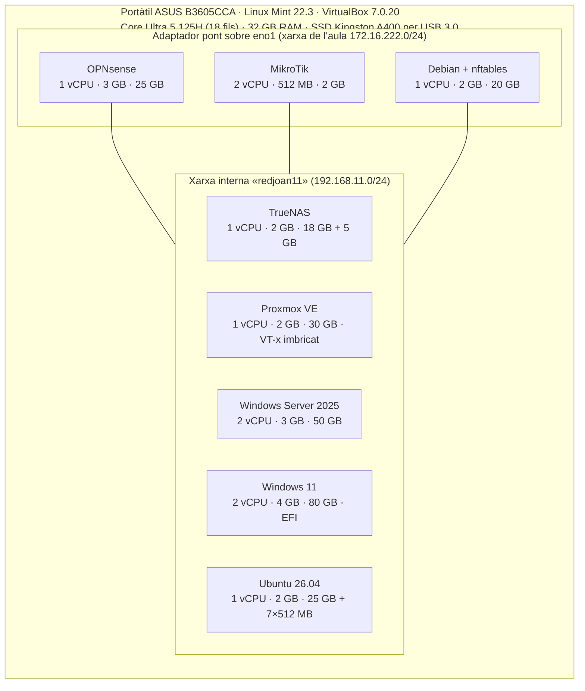

# Tasca 0 · Muntatge de l'entorn de proves individual

**Alumne:** Joan Brotons Vidal · Posició a l'aula **11** → LAN `192.168.11.0/24`
**RA:** FDM RA1 · **Hipervisor:** Oracle VirtualBox 7.0.20 sobre Linux Mint 22.3 (portàtil de classe)

| Què demana l'enunciat (individual) | On està |
|---|---|
| **Obligatori:** preparar un entorn de proves a l'equip propi que simule l'entorn del grup | §1, §2 |
| **Apte+:** documentar-lo en Markdown en un repositori Git personal, amb l'esquema de VM, els recursos de cadascuna i els problemes trobats amb la seua solució | Aquest repositori · §2 (esquema i recursos) · §4 (problemes) |

---

## 1. Què simula l'entorn

És una reproducció a escala del sistema de l'empresa, seguint l'esquema de "muntatge individual" que va donar el professor:

- **Tres servidors de comunicacions alternatius** (OPNsense, MikroTik i Debian amb nftables). Tenen la WAN a la xarxa de l'aula i la LAN a la xarxa interna.
- Una **LAN interna** on hi ha el NAS de còpies (TrueNAS), el node de virtualització (Proxmox), el controlador de domini (Windows Server 2025) i dos clients (Windows 11 i Ubuntu).

El portàtil no pot fer virtualització imbricada amb garanties (disc USB i 32 GB de RAM compartits per 8 VM). Per això, i per indicació del professor, el Proxmox només té configurada la xarxa i el Windows Server és una VM de VirtualBox independent en lloc d'anar dins del Proxmox.

## 2. Esquema de màquines virtuals i recursos assignats

Dades tretes de `VBoxManage showvminfo` el 16/11/2026:

| VM (nom a VirtualBox) | SO | vCPU | RAM | Disc(s) | Firmware | Adaptadors de xarxa |
|---|---|---|---|---|---|---|
| Servidor de Comunicaciones OPNsense | OPNsense 26.7 | 1 | 3 GB | 25 GB | BIOS | 1: pont `eno1` · 2: interna `redjoan11` |
| MikroTik | RouterOS 7.24.5 x86 | 2 | 512 MB | 2 GB | BIOS | 1: pont `eno1` · 2: interna `redjoan11` |
| Servidor de Comunicaciones Debian | Debian 13.1 | 1 | 2 GB | 20 GB | BIOS | 1: pont `eno1` · 2: interna `redjoan11` |
| TrueNas(Datos) | TrueNAS 27.0.0-RC.1 | 1 | 2 GB | 18 GB (sistema) + **5 GB (còpies)** | BIOS | interna `redjoan11` |
| Proxmox | Proxmox VE 9.2 | 1 | 2 GB | 30 GB | BIOS, **VT-x imbricat** | interna `redjoan11` |
| WinServer2025-DC | Windows Server 2025 Standard (escriptori) | 2 | 3 GB | 50 GB (SSD, **sense discard**) | BIOS | interna `redjoan11` |
| Windows 11 (Cliente) | Windows 11 Pro 23H2 | 2 | 4 GB | 80 GB | **EFI** | interna `redjoan11` |
| Ubuntu(Cliente) | Ubuntu 26.04.1 LTS | 1 | 2 GB | 25 GB + 7 × 512 MB (RAID, Tasca 6) | BIOS | interna `redjoan11` |
| **Total** | | **11** | **18,5 GB** | ~255 GB reservats (VDI dinàmics) | | |

**Per què aquests adaptadors:**
- **Pont** només a la WAN dels servidors de comunicacions. Reben IP del DHCP de l'aula, igual que al rack del grup.
- **Xarxa interna** per a tota la LAN. Només existeix dins del meu VirtualBox, de manera que cap trànsit de proves (ni cap DHCP) pot eixir a la xarxa compartida de l'aula, cosa que l'enunciat prohibeix. L'única eixida és a través dels servidors de comunicacions.

L'adreçament complet de cada interfície està a la [Tasca 4](Tasca4.md).

## 3. Recursos físics i limitacions

Dades reals (`lscpu`, `free`, `lsblk`, `lsusb -t`, `/sys`): [`evidencies/inventari-host-classe.txt`](evidencies/inventari-host-classe.txt). L'inventari complet està a la [Tasca 2](Tasca2.md).

| Recurs | Portàtil de classe | Conseqüència per a l'entorn |
|---|---|---|
| CPU | Intel Core Ultra 5 125H · 14 nuclis / 18 fils · VT-x | Sobrada (vegeu la [Tasca 7](Tasca7.md)) |
| RAM | 32 GB (31,3 GB útils) | Les 8 VM (18,5 GB) caben, però l'amfitrió es queda amb poc marge per a la memòria cau de disc |
| **Disc de les VM** | **Kingston A400 SATA 480 GB dins d'una caixa USB 3.0** | **És el coll de botella.** Límit pràctic de ~290 MB/s de lectura (mesurat) |
| Xarxa | Intel Gigabit Ethernet (`eno1`) | La WAN de les VM va en pont sobre aquesta interfície |

**Limitacions i com les he gestionades:**
1. **Disc:** amb diverses VM arrencant o instal·lant alhora, el disc USB arriba al 85-90 % d'ús. Les VM s'encenen per torns i les que no s'utilitzen es **guarden en estat** (*savestate*).
2. **RAM:** TrueNAS recomana 8 GB i Windows Server 4 GB amb escriptori. Aquí tenen 2 GB i 3 GB per a que càpien totes. Per a un laboratori funciona; per a producció, no.
3. **Virtualització imbricada:** el Proxmox només té la xarxa (acord amb el professor).
4. **Xarxa de l'aula:** el centre filtra NTP (UDP/123) i ICMP cap a Internet. Això afecta l'hora de les VM i les proves amb `ping` cap a fora.

## 4. Problemes trobats en el muntatge i solució

| # | Problema (símptoma) | Causa trobada | Solució |
|---|---|---|---|
| 1 | Diversos equips amb una IP que no era la seua (TrueNAS a la `.55`, LAN de l'OPNsense a la `.50`) | El MikroTik feia de servidor DHCP a la LAN amb el rang `.5-.55` | DHCP desactivat a tots els routers. IP manual a tota la LAN |
| 2 | No hi havia Internet a través del MikroTik | Faltava la regla NAT `masquerade` | Regla afegida i tallafocs complet ([Tasca 5](Tasca5.md)) |
| 3 | No hi havia Internet a través del Debian | `nftables.service` desactivat | `systemctl enable --now nftables` |
| 4 | `apt` falla amb "signatura no vàlida encara" | Rellotge endarrerit: l'NTP està bloquejat i les VM es reprenen des d'estat guardat | Sincronització de l'hora per HTTP ([`scripts/httptime.sh`](scripts/httptime.sh)) |
| 5 | L'Ubuntu arrencava l'instal·lador | La ISO seguia muntada i el DVD anava primer en l'ordre d'arrencada | ISO extreta i ordre d'arrencada amb el disc primer |
| 6 | Contrasenyes desconegudes (OPNsense, Proxmox, Windows Server antic) | No estaven documentades | Restabliment pels mecanismes oficials (opció 3 de la consola de l'OPNsense, `chpasswd` des de la consola de Proxmox) i reinstal·lació del Windows Server, que no tenia res configurat |
| 7 | La instal·lació del Windows Server amb EFI es quedava al 18 % i la VM no s'aturava | El procés de la VM estava bloquejat en una E/S de l'amfitrió | Reinstal·lació amb BIOS aplicant la imatge amb DISM ([Tasca 5 §4.1](Tasca5.md#41-installació)) |
| 8 | **El Windows Server es congelava** a la fase *specialize*, al primer inici de sessió i a l'escriptori (pantalla quieta i rellotge aturat), mentre el disc de l'amfitrió llegia a ~277 MB/s | El disc virtual tenia **discard/TRIM activat sobre un VDI dinàmic**. Quan Windows llança el TRIM, VirtualBox llig el fitxer `.vdi` sencer per compactar-lo | `VBoxManage storageattach … --discard off`. Després del canvi, la instal·lació dels rols ha anat sense cap bloqueig. Detall a la [Tasca 7](Tasca7.md) |

## 5. Repositori

- Remot: <https://github.com/Jowy293/Projecte-Iso-JoanBrotons>
- Un fitxer Markdown per tasca (`Tasca0.md` … `Tasca7.md`), amb les evidències a [`evidencies/`](evidencies/), les configuracions exportades a [`configs/`](configs/) i els scripts a [`scripts/`](scripts/).
- **Les contrasenyes no es guarden al repositori.**
