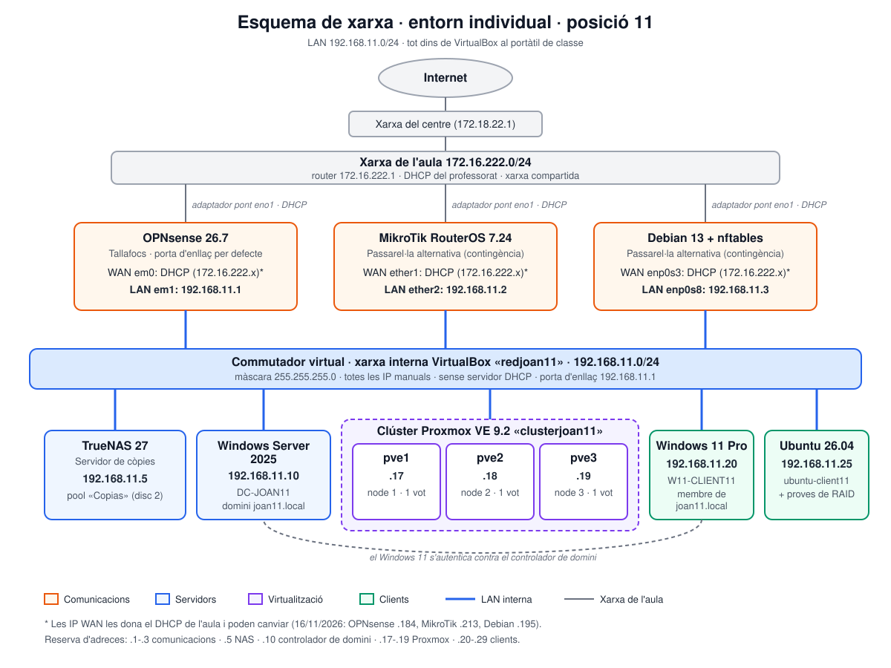
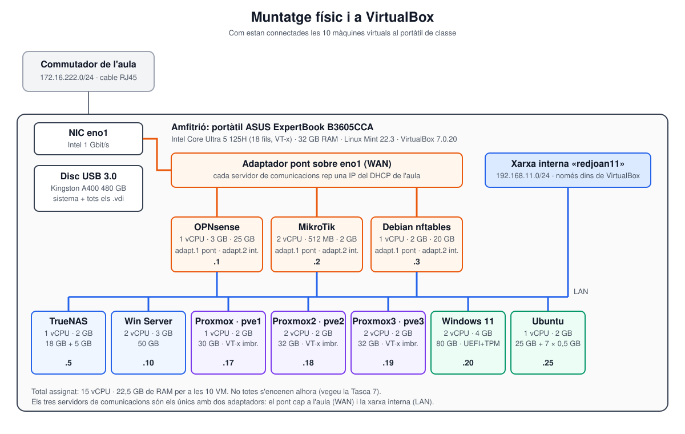

# Tasca 4 · Esquema de xarxa individual i verificació de la connectivitat

**Alumne:** Joan Brotons Vidal · Posició a l'aula **11** → LAN **`192.168.11.0/24`**
**RA:** FDM RA4 · ISO RA1 i RA3

| Què demana l'enunciat (individual) | On està |
|---|---|
| **Obligatori:** esquema de xarxa del sistema de prova amb la configuració que es crearà, el muntatge a VirtualBox i la xarxa utilitzada. La IP del servidor de comunicacions pot ser per DHCP i la xarxa és la `192.168.XX.0/24` (XX = posició) | apartats 1, 2 i 3 |
| **Apte+:** implementar l'esquema a VirtualBox i verificar la connectivitat entre totes les màquines i cap a l'exterior, amb evidències (ping, traceroute, taula d'encaminament i configuració de cada interfície) | apartat 4 |

---

## 1. Esquema de xarxa (lògic + muntatge a VirtualBox)





**Com es munta a VirtualBox:**

| Xarxa | Tipus d'adaptador VirtualBox | Qui hi està connectat | Per què |
|---|---|---|---|
| WAN (xarxa de l'aula) | **Adaptador pont** sobre `eno1` | Adaptador 1 dels tres servidors de comunicacions | Reben IP del DHCP de l'aula, com permet l'enunciat |
| LAN `192.168.11.0/24` | **Xarxa interna** `redjoan11` | Adaptador 2 dels servidors de comunicacions + adaptador únic de la resta | Només existeix dins del meu VirtualBox: cap trànsit de la LAN ni cap DHCP de proves pot eixir a la xarxa compartida de l'aula (l'enunciat ho prohibeix). L'única eixida és a través dels servidors de comunicacions |

## 2. Pla d'adreçament

| Paràmetre | Valor |
|---|---|
| Xarxa LAN | `192.168.11.0/24` (11 = la meua posició a l'aula) |
| Màscara | `255.255.255.0` |
| Passarel·la per defecte de la LAN | **`192.168.11.1`** (OPNsense). El MikroTik (`.2`) i el Debian (`.3`) són passarel·les alternatives per a contingència i proves |
| Mètode d'assignació | **Manual a tota la LAN.** Només les WAN dels servidors de comunicacions van per DHCP |
| Reserva | `.1-.3` comunicacions · `.5` NAS · `.10` DC · `.17-.19` clúster Proxmox · `.20-.29` clients |

## 3. Configuració de cada interfície

| Equip | Interfície | Adaptador VirtualBox | Mètode | IP / màscara | Passarel·la |
|---|---|---|---|---|---|
| OPNsense | em0 (WAN) | Pont `eno1` | DHCP | 172.16.222.184/24\* | 172.16.222.1 |
| | em1 (LAN) | Interna `redjoan11` | Estàtica | 192.168.11.1/24 | — |
| MikroTik | ether1 (WAN) | Pont `eno1` | DHCP | 172.16.222.213/24\* | 172.16.222.1 |
| | ether2 (LAN) | Interna `redjoan11` | Estàtica | 192.168.11.2/24 | — |
| Debian comms | enp0s3 (WAN) | Pont `eno1` | DHCP | 172.16.222.195/24\* | 172.16.222.1 |
| | enp0s8 (LAN) | Interna `redjoan11` | Estàtica | 192.168.11.3/24 | — |
| TrueNAS | enp0s3 | Interna `redjoan11` | Estàtica | 192.168.11.5/24 | 192.168.11.1 |
| Windows Server 2025 | Ethernet | Interna `redjoan11` | Estàtica | 192.168.11.10/24 | 192.168.11.1 |
| Proxmox (pve1) | vmbr0 (pont sobre nic0) | Interna `redjoan11` | Estàtica | 192.168.11.17/24 | 192.168.11.1 |
| Proxmox2 (pve2) | vmbr0 (pont sobre nic0) | Interna `redjoan11` | Estàtica | 192.168.11.18/24 | 192.168.11.1 |
| Proxmox3 (pve3) | vmbr0 (pont sobre nic0) | Interna `redjoan11` | Estàtica | 192.168.11.19/24 | 192.168.11.1 |
| Windows 11 | Ethernet | Interna `redjoan11` | Estàtica | 192.168.11.20/24 | 192.168.11.1 |
| Ubuntu client | enp0s3 (connexió `lan-estatica`) | Interna `redjoan11` | Estàtica | 192.168.11.25/24 | 192.168.11.1 |

\* IP donada pel DHCP de l'aula; pot canviar.

## 4. Verificació de la connectivitat (Apte+)

Totes les proves s'han fet amb les VM enceses, des de l'amfitrió, entrant per SSH a cada equip a través de la WAN del Debian.
Eixida completa sense retocar: [`evidencies/t4-connectivitat.txt`](evidencies/t4-connectivitat.txt) · Windows 11: [`evidencies/t4-win11.txt`](evidencies/t4-win11.txt) · Windows Server: [`evidencies/t4-winserver.txt`](evidencies/t4-winserver.txt)

### 4.1 Configuració de cada interfície (comprovada)

Les IP, màscares i passarel·les de la taula de l'apartat 3 coincideixen amb el que retornen els equips:

| Equip | Ordre | Resultat (extracte) |
|---|---|---|
| OPNsense | `ifconfig -a inet` | `em0 inet 172.16.222.184 netmask 0xffffff00` · `em1 inet 192.168.11.1 netmask 0xffffff00` |
| MikroTik | `/ip address print` | `192.168.11.2/24 ether2` · `D 172.16.222.213/24 ether1` (D = dinàmica, del DHCP) |
| Debian | `ip -br a` | `enp0s3 172.16.222.195/24` · `enp0s8 192.168.11.3/24` |
| TrueNAS | `ip -br a` | `enp0s3 192.168.11.5/24` |
| Proxmox | `ip -br a` | `nic0 UP` (sense IP, és port del pont) · `vmbr0 192.168.11.17/24` |
| Ubuntu | `ip -br a` | `enp0s3 192.168.11.25/24` |
| Windows 11 | `ipconfig /all` | `192.168.11.20`, màscara `255.255.255.0`, porta d'enllaç `192.168.11.1`, **DHCP habilitat: no** |
| Windows Server | `ipconfig /all` | `192.168.11.10`, màscara `255.255.255.0`, porta d'enllaç `192.168.11.1` |

### 4.2 Taules d'encaminament

| Equip | Ruta per defecte | Altres rutes |
|---|---|---|
| OPNsense | `default 172.16.222.1 UGS em0` | `192.168.11.0/24 link#2 em1` |
| MikroTik | `DAd 0.0.0.0/0 172.16.222.1` (apresa per DHCP) | `DAc 192.168.11.0/24 ether2` (connectada) |
| Debian | `default via 172.16.222.1 dev enp0s3 proto dhcp` | `192.168.11.0/24 dev enp0s8` |
| TrueNAS / Proxmox / Ubuntu | `default via 192.168.11.1` | `192.168.11.0/24` directament connectada |
| Windows 11 / Server | `0.0.0.0 0.0.0.0 192.168.11.1` | `192.168.11.0 255.255.255.0 En vínculo` |

**Interpretació:** tots els equips de la LAN tenen una sola ruta per defecte cap a l'OPNsense, i els tres routers en tenen una cap al router de l'aula per la seua WAN. No hi ha cap ruta "creuada" heretada d'un DHCP antic (era l'error que tenien l'OPNsense i el Proxmox abans de la Tasca 5).

### 4.3 Ping entre totes les màquines

Ping de 2 paquets des de cada equip a tota la LAN, en el moment en què les 8 VM estaven enceses (12:10):

| Origen ↓ / Destí → | .1 | .2 | .3 | .5 | .10 | .17 | .20 | .25 |
|---|---|---|---|---|---|---|---|---|
| OPNsense `.1` | — | OK | OK | OK | OK | OK | OK | OK |
| MikroTik `.2` | 2/2 | — | 2/2 | 2/2 | 2/2 | 2/2 | 2/2 | 2/2 |
| Proxmox `.17` | OK | OK | OK | OK | OK | — | OK | OK |
| TrueNAS `.5` | OK | OK | OK | — | OK | OK | OK | OK |

Les proves des de l'Ubuntu, el Debian i el Windows 11 donen OK a tots els equips encesos en aquell moment. Les fallades que apareixen a l'evidència (`.2`, `.17`, `.10`) corresponen a VM que estaven aturades o reiniciant quan es van fer, no a errors de xarxa. Es veu perquè els mateixos destins responen a les proves fetes des de l'OPNsense i el MikroTik amb totes les VM enceses.

**Nodes Proxmox nous:** després d'instal·lar el pve2 i el pve3, des del Debian (`.3`) responen els tres nodes del clúster: `.17` (0,25 ms), `.18` (0,36 ms) i `.19` (0,27 ms). A més, els tres nodes es comuniquen entre ells per corosync, perquè el clúster té quòrum (Tasca 5, apartat 3.5).

El MikroTik mostra el TTL de cada resposta: **64** als Linux/BSD i **128** als Windows (`.10`, `.20`). És el valor inicial de cada sistema, i confirma que les respostes venen directament de la LAN, sense passar per cap router.

### 4.4 Camí cap a l'exterior (traceroute)

Des de l'Ubuntu (`tracepath -n www.gva.es`):
```text
 1:  192.168.11.1      1.619ms     ← OPNsense (passarel·la de la LAN)
 2:  172.16.222.1      0.945ms     ← router de l'aula
 3:  172.18.22.1       0.961ms     ← xarxa del centre
 5:  81.46.22.5       14.118ms     ← operador (Internet)
```
Des del Windows 11 (`tracert -d 193.145.206.124`): `192.168.11.1 → 172.16.222.1 → 172.18.22.1 → 81.46.23.237 → 81.46.22.5 → 81.46.22.6`. Des de l'OPNsense, el primer salt ja és `172.16.222.1`, perquè el seu origen és la WAN.

**Eixida a Internet:** el Windows 11 connecta per TCP/443 a `www.gva.es` (`TcpTestSucceeded : True`) i l'Ubuntu en resol el nom (`193.145.206.124`).
**ICMP cap a Internet:** el `ping 8.8.8.8` no funciona des de cap equip de l'aula, ni des de l'amfitrió. És un filtre de la xarxa del centre, no un error del muntatge, i per això l'eixida es comprova per TCP/HTTP. El traceroute sí que arriba als routers de l'operador perquè aquests contesten amb "TTL excedit".

### 4.5 Les tres passarel·les funcionen

Canviant la passarel·la de l'Ubuntu a `.1`, `.2` i `.3` ([`evidencies/t5-proves-firewall-client.txt`](evidencies/t5-proves-firewall-client.txt)), el primer salt canvia a l'equip corresponent i l'HTTP a `deb.debian.org` respon **200** per les tres. Per tant, els tres servidors de comunicacions fan NAT i encaminament correctament. Les regles de cada tallafocs estan a la [Tasca 5](Tasca5.md).
