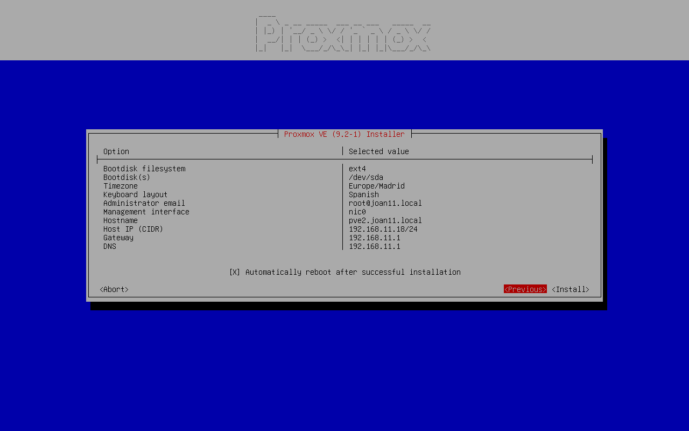
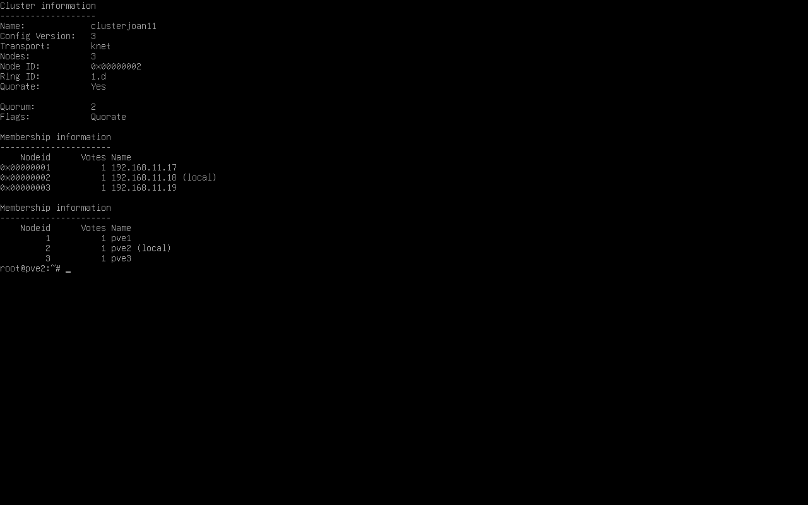
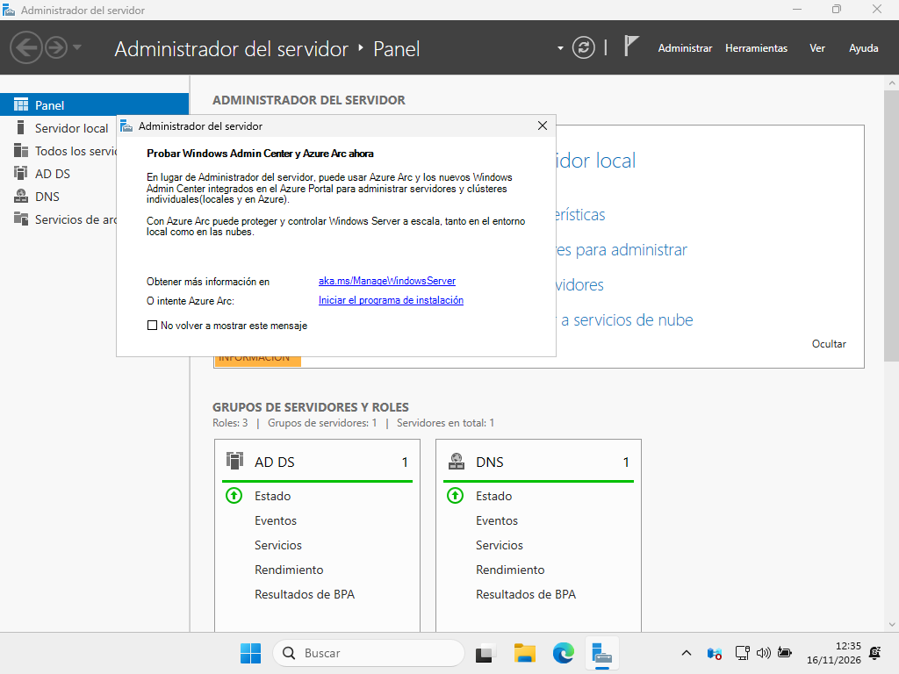
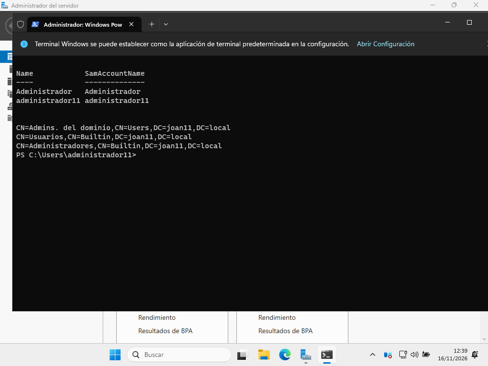
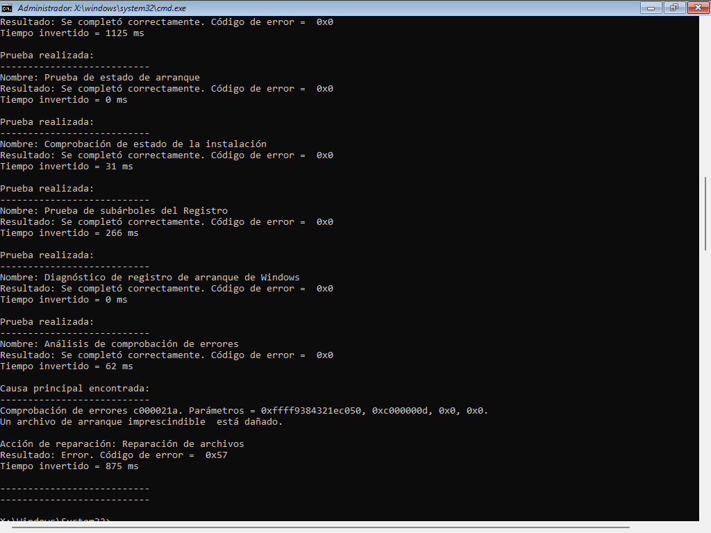
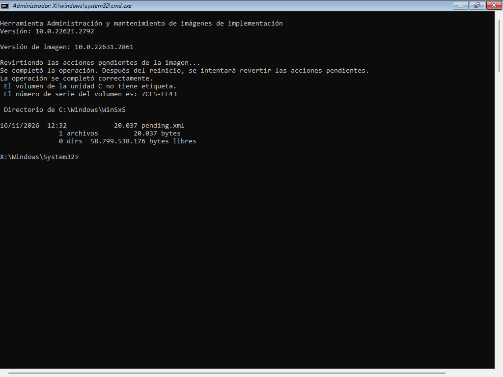
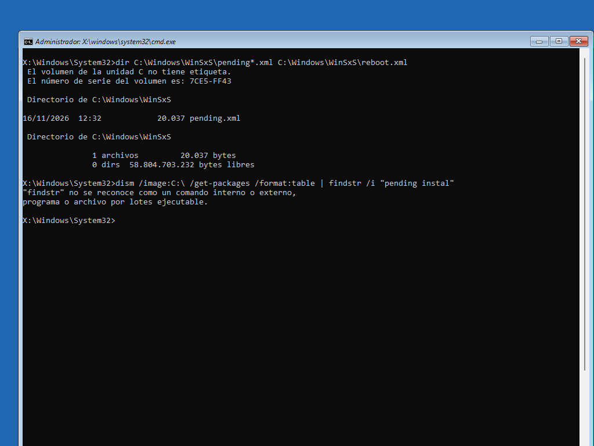
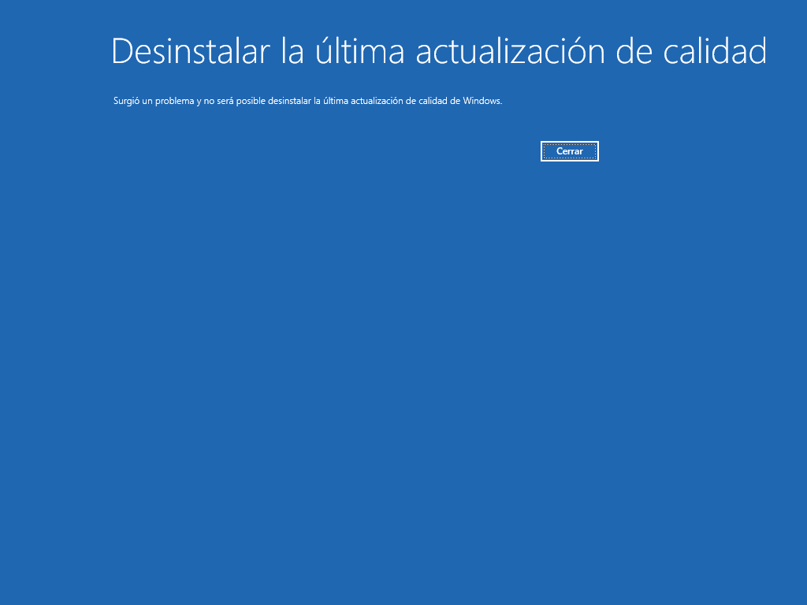
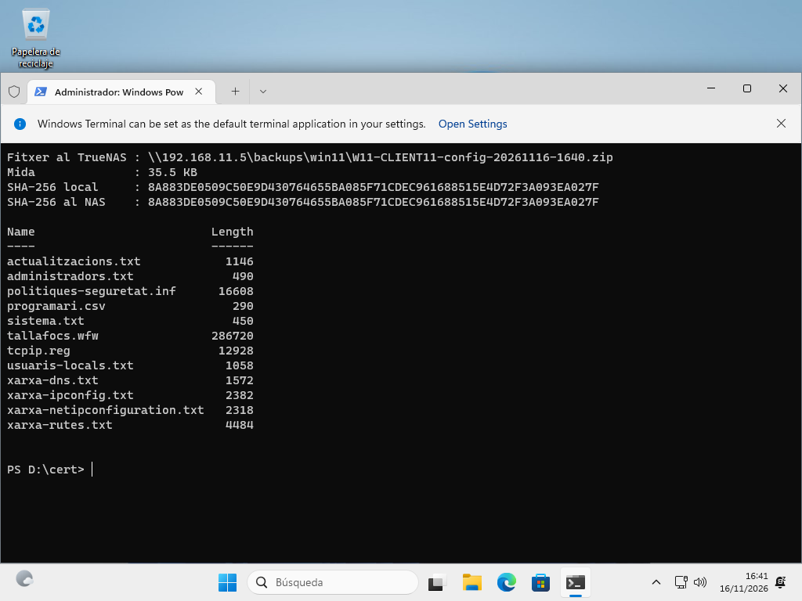

# Tasca 5 · Instal·lació i comunicacions

**Alumne:** Joan Brotons Vidal · Posició 11 · **RA:** ISO RA1 d-h · FDM RA1 b-d

| Què demana l'enunciat (individual) | On està |
|---|---|
| **Obligatori:** configurar al meu entorn de proves els mateixos sistemes que el grup: servidors de comunicacions (MikroTik, OPNsense, Debian amb nftables), TrueNAS, Proxmox, Windows Server 2025 i clients Windows 11 i GNU/Linux, cadascun amb les tasques de l'enunciat (usuari d'administració, xarxa, Internet per a la LAN, còpia al servidor de còpies, errada i recuperació…) | apartats 1 a 5 |
| Per a cada sistema: requisits, llicència i origen/integritat de la ISO; firmware i arrencada; versió; actualització i via de recuperació; una incidència d'instal·lació o arrencada real (símptoma, hipòtesi, comprovació, solució i retorn); una connexió permesa i una de bloquejada amb el registre | Dins de cada apartat |
| **Apte+:** implementar un sistema per a fer còpies de la configuració dels servidors crítics de l'entorn | apartats 2 (TrueNAS) i 6 |

---

## 1. Servidors de comunicacions: OPNsense, MikroTik i Debian + nftables

### 1.0 Decisió de disseny: una sola LAN, tres passarel·les, cap DHCP a la LAN

Els tres servidors de comunicacions comparteixen la mateixa xarxa interna `redjoan11` (192.168.11.0/24):

| Equip | LAN (estàtica) | WAN | Rol |
|---|---|---|---|
| OPNsense 26.7 | `192.168.11.1/24` | DHCP de l'aula (`172.16.222.x`, adaptador pont) | **Passarel·la per defecte** de tots els equips |
| MikroTik RouterOS 7.24.5 | `192.168.11.2/24` | DHCP de l'aula | Passarel·la alternativa (contingència) |
| Debian 13 + nftables | `192.168.11.3/24` | DHCP de l'aula | Passarel·la alternativa |

- **Només les WAN dels servidors de comunicacions van per DHCP.** Tota la resta d'equips té IP manual (vegeu [Tasca 4](Tasca4.md)).
- **Cap servidor fa DHCP a la LAN.** Al principi el MikroTik repartia el rang `.5-.55`. Això provocava que el TrueNAS acabara a la `.55` i que el **propi OPNsense** agafara la `.50` a la seua LAN, amb la ruta per defecte cap al MikroTik. Amb tres passarel·les a la mateixa LAN, si hi ha més d'un DHCP, cada client acaba amb una passarel·la diferent a l'atzar.
- Per a provar el MikroTik o el Debian, el client canvia la passarel·la (`ip route replace default via 192.168.11.2`). Així es fa a les proves de sota.

### 1.1 Comprovacions comunes abans d'instal·lar

| Sistema | ISO | SHA-256 (calculat a l'amfitrió) | Arquitectura / requisits |
|---|---|---|---|
| OPNsense | `OPNsense.iso` | `1efd5dc9…8d5dcd`* | amd64, 1 vCPU, ≥2 GB RAM (s'han assignat 3 GB), 25 GB |
| MikroTik | `mikrotik-7.24.5.iso` | `4bff16b8…aec02` | x86_64, 512 MB, 2 GB disc |
| Debian | `debian-13.1.0-amd64-netinst.iso` | `658b28e2…568b3` | amd64, 2 GB, 20 GB |

Llistat complet de hash: [`evidencies/iso-sha256.txt`](evidencies/iso-sha256.txt). Com es comprova: s'ha de comparar el hash calculat amb el que publica el fabricant (`SHA256SUMS` de Debian, `.sha256` d'OPNsense, `CHECKSUMS` de MikroTik a la pàgina de descàrregues).
\* Valor complet a l'evidència.

### 1.2 OPNsense (`192.168.11.1`)

| Ítem | Configuració |
|---|---|
| Versió | `OPNsense 26.7 (amd64)` (`opnsense-version`) |
| Hostname | `opnsense11` |
| Usuari d'administració | `root` (reset des de la consola, opció 3). Accés web `https://192.168.11.1` i SSH només des de la LAN |
| WAN `em0` | DHCP (pont `eno1`) → `172.16.222.184/24`, gw `172.16.222.1` |
| LAN `em1` | Estàtica `192.168.11.1/24`, sense gateway |
| NAT | *Outbound* automàtic: `nat on em0 from (em1:network) -> (em0:0)` |
| DHCP | **Desactivat** |
| Regles LAN | 1) `block` TCP/23 amb *log* (prova) · 2) `pass` LAN → any amb *log* |

**Problemes trobats i resolts:**
1. La LAN tenia la `.50` encara que el `config.xml` deia `.1`: hi havia un `dhclient` llançat per un procés `daemon -r` sobre `em1`, i ho re-aplicava a partir del *lease* guardat a `/var/db/dhclient.leases.em1`. Solució: matar el `daemon`, esborrar el *lease*, reassignar la IP des de la consola (opció 2) i reiniciar per comprovar que es manté.
2. La ruta per defecte anava pel MikroTik (`192.168.11.2`), també heretada del DHCP. Després de la correcció: `default 172.16.222.1 UGS em0`.

Extracte de la configuració (sense claus ni hash): [`configs/opnsense-extracte.xml`](configs/opnsense-extracte.xml)

### 1.3 MikroTik (`192.168.11.2`)

| Ítem | Configuració |
|---|---|
| Versió | RouterOS **7.24.5 (stable)**, x86_64 (`/system resource print`) |
| Identitat | `MikroTik-11` |
| Usuaris | `administrador11` (grup *full*). `admin` **desactivat**. `backup` (grup `copies`: només `ssh,read,sensitive,test,ftp`, sense `write`, només des de `192.168.11.5`, amb clau SSH) |
| WAN `ether1` | Client DHCP → `172.16.222.213/24` |
| LAN `ether2` | `192.168.11.2/24` |
| NAT | `srcnat out-interface-list=WAN action=masquerade` (**no existia: per això no hi havia Internet a través del MikroTik**) |
| DHCP | Servidor `dhcp1` **desactivat**; pool reduït a `.200-.220` per si cal activar-lo en contingència |
| Firewall | input: establertes, ICMP, LAN, SSH/Winbox només des de 172.16.222.0/24, resta WAN *drop+log* · forward: establertes, **Telnet LAN→fora *drop+log* (`MK-BLOQ-TELNET`)**, LAN→WAN *accept*, WAN→LAN *drop+log* |

Configuració exportada (sense dades sensibles): [`configs/mikrotik-export.rsc`](configs/mikrotik-export.rsc)

**Limitació detectada:** és la imatge x86 sense llicència (`ROUTER HAS NO SOFTWARE KEY`, mode de prova de 24 h). Per a un ús continu s'hauria d'utilitzar la imatge **CHR** (llicència gratuïta *free*, limitada a 1 Mbps per interfície) o comprar una llicència de nivell 4.

### 1.4 Debian 13 + nftables (`192.168.11.3`)

| Ítem | Configuració |
|---|---|
| Versió | Debian GNU/Linux 13 (trixie), nucli 6.12.113 |
| Hostname | `deb-comms11` |
| Usuaris | `administrador11` (afegit al grup `sudo`; abans no tenia permisos) i `root` |
| WAN `enp0s3` | DHCP per `ifupdown` (`/etc/network/interfaces`) |
| LAN `enp0s8` | `192.168.11.3/24` estàtica |
| Encaminament | `net.ipv4.ip_forward=1` persistent a `/etc/sysctl.d/99-router.conf` |
| Tallafocs | `/etc/nftables.conf` → [`configs/debian-nftables.conf`](configs/debian-nftables.conf) (input i forward amb política `drop`, NAT `masquerade`, bloqueig de Telnet amb *log* `DEB-BLOQ-TELNET`) |
| Serveis | Arrenca en mode text (`multi-user.target`): s'han desactivat l'escriptori GNOME (`gdm`), `cups`, `avahi` i `ModemManager`, que no calen en un tallafocs. Arrencada de 1 min 6 s a 4,9 s i RAM de 639 a 276 MB ([Tasca 7, apartat 4.2](Tasca7.md)) |
| SSH | `openssh-server` instal·lat (no ho estava) |

**Problemes trobats i resolts:**
1. `nftables.service` estava **inactive (dead)**: el fitxer tenia el NAT però no s'aplicava mai → la LAN no eixia per la `.3`. Solució: `systemctl enable --now nftables`.
2. La WAN tenia **dues IP** (`.194` i `.195`) perquè la gestionaven alhora `ifupdown` i NetworkManager. Solució: `/etc/NetworkManager/conf.d/10-ifupdown-gestiona.conf` amb `unmanaged-devices` per a `enp0s3` i `enp0s8`.
3. NTP (UDP/123) està bloquejat a la xarxa de l'aula i el rellotge quedava endarrerit (les VM es reprenen des d'estat guardat). Això feia fallar `apt` ("signatura no vàlida encara"). Solució: script [`scripts/httptime.sh`](scripts/httptime.sh) amb un *timer* de systemd que agafa l'hora de la capçalera `Date` d'HTTP.

### 1.5 Connexió permesa i connexió bloquejada (amb registre)

Client: Ubuntu `192.168.11.25`. S'ha canviat la passarel·la a `.1`, `.2` i `.3` successivament ([`scripts/fwtest.sh`](scripts/fwtest.sh)).
Evidència: [`evidencies/t5-proves-firewall-client.txt`](evidencies/t5-proves-firewall-client.txt) i [`evidencies/t5-logs-firewalls.txt`](evidencies/t5-logs-firewalls.txt)

| Passarel·la | tracepath | Permesa: HTTP a deb.debian.org:80 | Bloquejada: TCP 1.1.1.1:23 |
|---|---|---|---|
| `.1` OPNsense | 192.168.11.1 → 172.16.222.1 → 172.18.22.1 | OK 0,51 s | sense resposta |
| `.2` MikroTik | 192.168.11.2 → 172.16.222.1 → … | OK 0,45 s | sense resposta |
| `.3` Debian | 192.168.11.3 → 172.16.222.1 → … | OK 0,47 s | sense resposta |

**Interpretació dels registres:**

- **OPNsense** (`/var/log/filter/latest.log`):
  ```
  ... 949c6a24-...,em1,match,pass,in,4,...,tcp,60,192.168.11.25,199.232.34.132,34914,80,0,S,...
  ... 5cabc572-...,em1,match,block,in,4,...,tcp,60,192.168.11.25,1.1.1.1,33056,23,0,S,...
  ```
  Camps: UUID de la regla que ha fet *match*, interfície `em1` (LAN), acció (`pass`/`block`), sentit `in`, IPv4, protocol TCP, origen, destinació, port origen, **port destí** (80/23) i *flag* `S` (SYN, intent de connexió nova). El bloqueig es repeteix 5 vegades amb el mateix port origen 33056: són les **retransmissions del SYN** del client, que no rep resposta.
- **MikroTik** (`/log print`):
  `MK-BLOQ-TELNET forward: in:ether2 out:ether1, connection-state:new src-mac 08:00:27:C2:F7:C9, proto TCP (SYN), 192.168.11.25:54500->1.1.1.1:23`. Inclou la MAC del client (la de l'Ubuntu), i els comptadors de la regla 8 (`10 paquets, 600 bytes`) confirmen que ha actuat.
- **Debian** (`journalctl -k`):
  `DEB-BLOQ-TELNET IN=enp0s8 OUT=enp0s3 ... SRC=192.168.11.25 DST=1.1.1.1 ... PROTO=TCP SPT=54514 DPT=23 ... SYN`. `IN/OUT` indica que el paquet anava a ser reenviat (cadena *forward*) de la LAN a la WAN.

Nota: el `ping 8.8.8.8` **no funciona des de cap equip de l'aula** (ni des de l'amfitrió): la xarxa del centre filtra l'ICMP cap a Internet. Per això la connectivitat externa es prova amb HTTP.

### 1.6 Còpia de la configuració al servidor de còpies

La còpia es fa **manualment** quan la configuració està acabada: `copia-servidors.sh`, executat al TrueNAS, va a buscar la configuració per SSH amb clau. Detall a l'[apartat 2](#2-truenas-servidor-de-còpies-192168115).

| Equip | Què es copia | Fitxer al TrueNAS | Mida |
|---|---|---|---|
| OPNsense | `/conf/config.xml` (tota la configuració en un fitxer) | `opnsense/config-opnsense11-20261116-1046.xml` | 38 KB |
| MikroTik | `/export show-sensitive` (text, reimportable) | `mikrotik/mikrotik11-20261116-1052.rsc` | 2,4 KB |
| Debian | `tar` de `/etc/nftables.conf`, `interfaces`, `sysctl.d`, `sshd_config`, `hosts`, NM i el *timer* d'hora | `debian-comms/deb-comms11-etc-…tar.gz` | 3,7 KB |

**Què NO es copia i per què:** la imatge sencera del disc (OPNsense 25 GB, Debian 20 GB) no cap al pool de 5 GB i no cal: reinstal·lar des de la ISO verificada + restaurar la configuració és més ràpid i ocupa uns quants KB.

### 1.7 Errada controlada i recuperació

Durant cada prova, el client Ubuntu executava [`scripts/probe.sh`](scripts/probe.sh): fa un `wget` cada segon per la passarel·la provada i registra els canvis d'estat.

| Equip | Errada provocada | Recuperació | Caiguda observada pel client | Evidència |
|---|---|---|---|---|
| Debian | `rm /etc/nftables.conf; nft flush ruleset` (es perd el NAT) | Des del TrueNAS: `cat còpia.tar.gz \| ssh root@.3 "tar xzf - -C / etc/nftables.conf && systemctl restart nftables"` | **13 s** (10:40:33 → 10:40:46, 12 s eren d'espera) | [`t5-fallada-debian.txt`](evidencies/t5-fallada-debian.txt) |
| OPNsense | S'esborra la regla *Default allow LAN to any* i es recarrega el filtre | Es restaura `config.xml` des del TrueNAS + `configctl filter reload` | **13 s** (10:52:59 → 10:53:12) | [`t5-fallada-opnsense.txt`](evidencies/t5-fallada-opnsense.txt) |
| MikroTik | **Reset de fàbrica** `/system reset-configuration no-defaults=yes` | Consola: IP temporal → `/tool fetch mode=sftp` de la còpia del TrueNAS → `/ip address remove [find]; /import restore.rsc` → tornar a crear els usuaris | **1 min 51 s** (10:49:45 → 10:51:36, inclou el reinici) | [`t5-fallada-mikrotik.txt`](evidencies/t5-fallada-mikrotik.txt) |

**Lliçons apreses (reals, eixides de les proves):**
- `/export` del MikroTik **no inclou els usuaris ni les claus SSH**: després d'importar cal recrear `administrador11` i `backup`. Millora: guardar també un `/system backup` binari (inclou usuaris) a més de l'export de text.
- Després del reset, el MikroTik genera una **clau de host SSH nova** i la primera còpia posterior va fallar ("REMOTE HOST IDENTIFICATION HAS CHANGED"). És el comportament segur; es resol amb `ssh-keygen -R 192.168.11.2` un cop comprovat que el canvi és legítim.
- Al Debian i a l'OPNsense, la recuperació en si dura menys de 2 s; la major part de la caiguda és el temps a detectar el problema.

## 2. TrueNAS: servidor de còpies (192.168.11.5)

### 2.1 Sistema

| Ítem | Valor |
|---|---|
| Versió | `TrueNAS-27.0.0-RC.1` (`midclt call system.version`). ISO `TrueNAS-27.0.0-RC.1.iso`, SHA-256 `515a0252…498e` |
| VM | 1 vCPU, 2 GB RAM, disc de sistema 18 GB (`boot-pool`) + **disc addicional de 5 GB** (`sdb`) per a les còpies |
| Hostname | `truenas11` · zona horària `Europe/Madrid` |
| Xarxa | `enp0s3` **estàtica** `192.168.11.5/24`, gw `192.168.11.1` |
| Usuaris | `truenas_admin` (administrador, accés web i SSH) · `backup_user` (propietari de les còpies, home `/mnt/Copias/backups`) |
| Serveis | SSH (amb contrasenya per als administradors, amb clau per a les còpies) · SMB (recurs `backups`) · **FTP desactivat** (anava en clar i no feia falta) |

> **Requisit oficial:** TrueNAS recomana ≥8 GB de RAM per a ZFS. Aquí té 2 GB perquè el pool és de 5 GB i és un laboratori: funciona, però no és una configuració de producció.

**Problema trobat:** el TrueNAS estava en **DHCP** i agafava la `.55`, l'última IP del pool del MikroTik (`.5-.55`). Al README antic s'havia escrit `.55` com si fos una IP fixa. Ara està en estàtica a la `.5` (`interface.update` + `interface.commit` amb *rollback* automàtic de 60 s per si es perdia l'accés).

### 2.2 Espai de còpies: què, com i on

Pool ZFS **`Copias`** sobre el disc addicional de 5 GB (no al disc del sistema: si el sistema del NAS es trenca, les còpies sobreviuen al seu propi disc).

```
NAME                         QUOTA   COMPRESS
Copias/backups                  4G   lz4      ← propietari backup_user, permisos 750
Copias/backups/opnsense       200M   lz4
Copias/backups/mikrotik       200M   lz4
Copias/backups/debian-comms   300M   lz4
Copias/backups/proxmox        300M   lz4
Copias/backups/winserver        1G   lz4
Copias/backups/win11          512M   lz4
Copias/backups/ubuntu         512M   lz4
Copias/backups/historic       200M   lz4      ← còpies manuals antigues (27/10) conservades
```

- **Un dataset per equip amb quota** (RA3 g): si un equip genera còpies descontrolades, només omple la seua quota i no bloqueja les còpies de la resta. Les quotes s'han posat amb `zfs set quota=` perquè l'API de TrueNAS 27 exigeix un mínim d'1 GB.
- **Compressió LZ4**: els fitxers de configuració són text i es comprimeixen molt.
- El dataset antic `copias_de_seguiridad` (nom amb errata, compartit per SMB i FTP) s'ha eliminat després de copiar-ne el contingut a `historic/`.

#### Com arriba cada còpia (el TrueNAS ha de ser accessible per a deixar-hi les còpies)

| Tipus d'equip | Mètode | Per què |
|---|---|---|
| Servidors Linux/BSD/RouterOS (OPNsense, MikroTik, Debian, Proxmox) | **Pull per SSH** des del TrueNAS amb la clau `backup_user@truenas11` ([`scripts/copia-servidors.sh`](scripts/copia-servidors.sh)) | Els servidors no guarden cap credencial per a escriure al NAS. Si un servidor queda compromés, no pot esborrar les còpies. Les claus estan limitades amb `from="192.168.11.5"` |
| Client Ubuntu | **Push per SFTP/SCP** a `backup_user@192.168.11.5` | L'usuari deixa la seua còpia quan vol |
| Windows (Server i 11) | **Push per SMB** al recurs `\\192.168.11.5\backups` (usuari `backup_user`) | Protocol natiu de Windows (`robocopy`, Explorador, `wbadmin`) |

Per indicació del professorat, **les còpies no s'automatitzen** (no hi ha cron ni snapshots periòdics). Es fan a mà quan cada equip està acabat:

```bash
# Al TrueNAS, com a backup_user
sudo -u backup_user /mnt/Copias/backups/scripts/copia-servidors.sh tots     # o opnsense | mikrotik | debian | proxmox
```

L'script verifica que el fitxer no estiga buit i mostra la mida i el `sha256`. Si una còpia ix buida, l'esborra i diu `ERROR`. Va passar de veritat després del reset del MikroTik: havia canviat la clau de host.

### 2.3 Recuperació provada
Les tres recuperacions de l'[apartat 1.7](#1-servidors-de-comunicacions-opnsense-mikrotik-i-debian--nftables) s'han fet **a partir d'aquestes còpies**: el MikroTik es va descarregar la seua per SFTP (`/tool fetch mode=sftp ... user=backup_user`), i al Debian i a l'OPNsense el TrueNAS els va retornar el fitxer per SSH.

## 3. Proxmox VE: clúster de 3 nodes (192.168.11.17, .18 i .19)

> Dins dels Proxmox **no hi ha cap màquina virtual ni contenidor**: a l'entorn individual només es configuren els nodes, la xarxa, els usuaris d'administració i el clúster.

Evidències: [`evidencies/t5-proxmox-estat.txt`](evidencies/t5-proxmox-estat.txt) · [`evidencies/t5-proxmox-cluster.txt`](evidencies/t5-proxmox-cluster.txt) · [`evidencies/t5-proxmox-copia.txt`](evidencies/t5-proxmox-copia.txt)

### 3.1 Sistema

| Ítem | Valor |
|---|---|
| Versió | `pve-manager/9.2.2` (nucli 7.0.2-6-pve), base Debian 13 trixie |
| ISO | `proxmox-ve_9.2-1.iso` · SHA-256 `4e88fe41…f0395` **coincideix** amb `enterprise.proxmox.com/iso/SHA256SUMS` |
| Instal·lació | Instal·lador en mode text (*Terminal UI*): disc `ext4`, país Espanya, zona `Europe/Madrid`, teclat espanyol |

| Node | VM VirtualBox | Hostname | IP (`vmbr0`) | Recursos |
|---|---|---|---|---|
| 1 | `Proxmox` | `pve1.joan11.local` | `192.168.11.17/24` | 1 vCPU, 2 GB, 30 GB · VT-x imbricat |
| 2 | `Proxmox2` | `pve2.joan11.local` | `192.168.11.18/24` | 2 vCPU, 2 GB, 32 GB · VT-x imbricat |
| 3 | `Proxmox3` | `pve3.joan11.local` | `192.168.11.19/24` | 2 vCPU, 2 GB, 32 GB · VT-x imbricat |

Tots tres a la xarxa interna `redjoan11`, amb porta d'enllaç `192.168.11.1` (OPNsense) i els tres noms a `/etc/hosts` de cada node.

| | |
|---|---|
|  |  |
| Resum abans d'instal·lar el node 2 | Resum abans d'instal·lar el node 3 |

### 3.2 Usuaris d'administració

| Usuari | Realm | Permisos |
|---|---|---|
| `root@pam` | PAM | Superusuari (necessari per al clúster i la consola) |
| `administrador11@pam` | PAM | Rol `Administrator` sobre `/` (ACL). Usuari Linux creat amb `useradd` i afegit a Proxmox amb `pveum user add` |

Els usuaris de Proxmox es guarden a `/etc/pve/user.cfg`, que el clúster replica als tres nodes. Com que el realm és **PAM**, l'usuari Linux `administrador11` s'ha creat també al pve2 i al pve3 (`useradd`). L'instal·lador obliga a posar una contrasenya de root de 8 caràcters com a mínim; després s'ha canviat amb `chpasswd` perquè siga la mateixa als tres nodes.

Accés web: `https://192.168.11.17:8006` (o `.18`, `.19`: des de qualsevol node es gestiona tot el clúster).

### 3.3 Xarxa

```text
auto vmbr0
iface vmbr0 inet static
        address 192.168.11.17/24
        gateway 192.168.11.1        # abans 192.168.11.2 (MikroTik)
        bridge-ports nic0
        bridge-stp off
        bridge-fd 0
```

- `vmbr0` és el pont Linux on es connectarien les VM i contenidors. El pve2 i el pve3 tenen la mateixa configuració amb la seua IP (`.18` i `.19`).
- Canvis aplicats amb `ifreload -a`, sense reiniciar.

### 3.4 Repositoris i actualització

- Als tres nodes s'han desactivat `pve-enterprise` i `ceph` (sense subscripció donen error 401) i s'ha afegit `pve-no-subscription`. Els fitxers originals estan a `/root/repos-desactivats/`.
- `apt update` funciona, i hi ha **130 paquets actualitzables**. **No s'ha fet `dist-upgrade`**: els tres nodes tenen la mateixa versió (9.2.2), que és el que importa en un clúster.
- Problema trobat: `apt update` fallava amb "signatura no vàlida fins a …" perquè el rellotge anava endarrerit (NTP bloquejat a l'aula i VM represa des d'estat guardat). S'ha resolt amb [`scripts/httptime.sh`](scripts/httptime.sh).
- **Problema trobat en muntar el clúster:** el pve1 anava un dia endarrerit (represa des d'estat guardat) i el pve2 i el pve3 anaven **una hora avançats**: VirtualBox dona el rellotge de la placa en hora local i Linux el llegia com si fora UTC. En un clúster les hores dels nodes han de coincidir (corosync i els certificats en depenen). Solució als tres nodes: `timedatectl set-local-rtc 1` (el rellotge de la placa va en hora local), hora posada des de l'amfitrió i `hwclock --systohc`.

### 3.5 Còpia de la configuració

`copia-servidors.sh proxmox`, llançat a mà al TrueNAS. Després de crear el clúster s'ha tornat a fer: `proxmox/pve1-config-20261117-1006.tar.gz` (**21,2 KB**, abans 13,8 KB), que ja conté `corosync.conf`, `.members` i les carpetes dels tres nodes (`nodes/pve1`, `pve2`, `pve3`):

| Es copia | Per què |
|---|---|
| `/etc/pve/` (`corosync.conf`, storage.cfg, user.cfg, `nodes/`, firewall, certificats i claus de `priv/`) | És tota la configuració del clúster (sistema de fitxers `pmxcfs`). Com que el clúster la replica als tres nodes, n'hi ha prou amb copiar-la d'un |
| `/etc/network/interfaces`, `hosts`, `hostname`, `resolv.conf` | Xarxa i identitat del node |
| `/etc/apt/sources.list.d/` | Repositoris |

**No es copia:** el sistema operatiu (es reinstal·la des de la ISO en ~10 min) ni els discos de les VM. Les VM es copiarien amb `vzdump` cap a un emmagatzematge separat (el TrueNAS per NFS o un Proxmox Backup Server), no amb un `tar`.
**Compte:** la còpia conté claus privades (`priv/`): només la pot llegir `backup_user` (permisos 750 al dataset).

### 3.6 Clúster `clusterjoan11`

| Pas | Ordre | Resultat |
|---|---|---|
| 1. Crear el clúster al pve1 | `pvecm create clusterjoan11 --link0 192.168.11.17` | Genera la clau de corosync (`/etc/corosync/authkey`) i `/etc/pve/corosync.conf` |
| 2. Afegir el pve2 | Al pve2: `pvecm add 192.168.11.17 --link0 192.168.11.18` (demana la contrasenya de root del pve1 i confirmar la seua empremta X509) | `successfully added node 'pve2' to cluster`. El node rep un certificat nou signat per l'autoritat del clúster |
| 3. Afegir el pve3 | Al pve3: `pvecm add 192.168.11.17 --link0 192.168.11.19` | `successfully added node 'pve3' to cluster` |
| 4. Comprovació | `pvecm status` i `pvecm nodes` **a cadascun dels tres nodes** | `Nodes: 3`, `Expected votes: 3`, `Quorum: 2`, `Quorate: Yes`. Els tres nodes en línia |

| | |
|---|---|
|  |  |
| `pvecm status` al pve2 | `pvecm status` al pve3 |

**Per què 3 nodes:** cada node té un vot i el clúster necessita la majoria (**quòrum = 2**) per a funcionar. Amb 3 nodes, si en cau un, els altres dos continuen tenint quòrum. Amb només 2, la caiguda d'un deixaria l'altre sense quòrum i bloquejaria `/etc/pve`.

**Limitació de l'entorn:** la xarxa del clúster (corosync, `link0`) va per la mateixa LAN que els usuaris. En una instal·lació real aniria per una xarxa separada perquè el trànsit dels usuaris no afecte la comunicació entre nodes.

### 3.7 Gestió conjunta, migració, contenidors i virtualització (teoria)

- **Gestió conjunta / migració / HA:** amb clúster, tots els nodes es gestionen des d'una web (gestió conjunta). La **migració** mou una VM d'un node a un altre: en calent si el disc està en emmagatzematge compartit, en fred copiant el disc si no. L'**alta disponibilitat (HA)** reinicia automàticament la VM en un altre node si el seu cau, i necessita quòrum i emmagatzematge compartit (NFS/iSCSI al TrueNAS o Ceph).
- **Contenidor vs màquina virtual:** el contenidor LXC comparteix el nucli del host: arrenca en segons i ocupa centenars de MB, però només pot executar Linux i aïlla menys. La VM (KVM) té nucli propi: pot executar Windows o BSD i aïlla més, però costa més RAM i disc. A l'empresa: **LXC** per a serveis Linux lleugers (monitoratge, web interna), i **VM** per al Windows Server, el tallafocs virtual o qualsevol cosa que necessite un nucli diferent.
- **Avantatges de virtualitzar servidors:** consolidació (menys maquinari i consum), instantànies abans d'un canvi, còpia i restauració de la VM sencera, migració. **Inconvenients:** un host que cau s'emporta totes les seues VM (cal clúster/HA), sobrecost de RAM i E/S, i una complexitat i llicències (Windows per nucli) que cal planificar.

## 4. Windows Server 2025: controlador de domini joan11.local (192.168.11.10)

> Per indicació del professor, el Windows Server, que a l'arquitectura de referència va dins del clúster Proxmox, s'ha instal·lat **com a VM de VirtualBox independent** per falta de recursos per a la virtualització imbricada.

### 4.1 Instal·lació

| Ítem | Valor |
|---|---|
| ISO | `WinServer.iso` → *Windows Server 2025 Standard Evaluation (experiència d'escriptori)*, build **10.0.26100.32230**, es-ES (detectat amb `VBoxManage unattended detect`) |
| Requisits oficials | CPU x64 1,4 GHz amb SLAT, 512 MB RAM (2 GB amb escriptori), 32 GB de disc, TPM 2.0 i UEFI/Secure Boot **recomanats** però no obligatoris (a diferència de Windows 11) |
| Recursos assignats | 2 vCPU, 3 GB RAM, disc de 50 GB (marcat SSD, amb TRIM), BIOS |
| Llicència | Avaluació de 180 dies (no necessita clau) |
| Nom d'equip | `DC-JOAN11` |
| Usuari d'administració | `administrador11` (administrador local; en promocionar a DC passa a ser administrador del domini). `Administrador` integrat desactivat per Windows |

#### Incidència d'instal·lació real (punt 5 de la tasca): símptoma → hipòtesi → comprovació → solució

| Pas | Detall |
|---|---|
| **Estat inicial** | La VM antiga (`Windows Server(Claster)`) tenia el Windows instal·lat però **cap configuració de xarxa i una contrasenya desconeguda** (cap de les contrasenyes conegudes funcionava). Com que no tenia res configurat, es decideix reinstal·lar en lloc de forçar l'accés |
| **Símptoma 1** | Instal·lació desatendida (`VBoxManage unattended install`) amb firmware **EFI**: l'instal·lador es queda en "18 % completat" durant més de 30 min, el disc USB de l'amfitrió llegeix contínuament a **~293 MB/s** (85-90 % d'utilització) i la VM no respon a `pause` ni a `poweroff` (estat `stopping`) |
| Hipòtesi | Les VM no són: els comptadors d'E/S de cada VM (`VBoxManage debugvm … statistics`) donen 0 MB/s. Per tant, el procés `VBoxHeadless` de la VM està bloquejat en una E/S de l'amfitrió |
| Comprovació | Amb `/proc/diskstats` es mesura sda3 abans i després d'aturar la VM: **293 MB/s → 0 MB/s** en matar el procés `VBoxHeadless` del Windows Server. Causa confirmada |
| **Símptoma 2** | Reinstal·lació amb **BIOS**: l'instal·lador s'atura a "Seleccionar ubicació" amb l'error *"Error al seleccionar esta partición para instalarla"* |
| Hipòtesi | La plantilla de VirtualBox crea la partició però **no la formata ni la marca activa** (no té `<ModifyPartitions>`) |
| Comprovació | `autounattend.xml` generat: només `CreatePartition`. A més, `dir A:\` a la consola de WinPE (Shift+F10) mostra que l'instal·lador llig la còpia **del disquet A:** (11 014 bytes, sense corregir) abans que la de la unitat E: (11 236 bytes, corregida) |
| **Solució** | Des de la consola de WinPE: `diskpart` (clean, MBR, partició primària, `format fs=ntfs quick`, `active`, `assign letter=C`) → `dism /Apply-Image /ImageFile:D:\sources\install.wim /Index:2 /ApplyDir:C:\` → `bcdboot C:\Windows /s C: /f BIOS` → copiar `autounattend.xml` a `C:\Windows\Panther\unattend.xml`, perquè les fases *specialize* i *oobeSystem* creen l'usuari, el nom i la IP |
| Retorn | Si la nova instal·lació fallava, la VM es pot tornar a crear igual (disc nou de 50 GB). No hi havia dades a perdre |
| Temps | Diagnòstic ~20 min. Aplicació de la imatge amb DISM ~25 min (limitada pel disc USB) |

### 4.2 Què és un domini i què aporta a l'empresa

Un **domini Active Directory** és una base de dades centralitzada (al controlador de domini) amb tots els **usuaris, grups, equips i polítiques** de l'organització. Els equips units al domini deleguen l'autenticació al DC (Kerberos), de manera que un usuari té **un sol compte** per a tots els equips i recursos.

Què aporta a l'empresa de l'enunciat (direcció, administració, comercial, producció i informàtica):

| Sense domini (grup de treball) | Amb domini `joan11.local` |
|---|---|
| Un compte local diferent a cada PC; canviar una contrasenya vol dir anar equip per equip | Un compte per persona, creat una vegada; si algú se'n va, es desactiva i perd l'accés a tot |
| Els permisos de les carpetes compartides s'han de repetir a cada servidor | Permisos per **grups** (G_Comercial, G_Direccio…) aplicats a tots els recursos |
| Configuració manual de cada PC | **GPO**: fons, unitats de xarxa mapades, bloqueig d'USB, actualitzacions, contrasenyes segures… aplicades automàticament per OU |
| No hi ha registre central de qui entra on | Auditoria centralitzada d'inicis de sessió |

**Inconvenients acceptats:** el DC es converteix en un punt crític. Si cau, no es pot iniciar sessió en equips nous. A producció en caldrien dos, i aquí només n'hi ha un. També costa llicències (CAL) i administració.

L'enunciat diu que la implantació completa de dominis i polítiques (OU, GPO) correspon a fases posteriors (RA4/RA5). **S'ha creat el domini i s'hi ha unit el Windows 11** (apartat 5.6), sense OU ni GPO.

### 4.3 Configuració: nom, usuari d'administració, xarxa i creació del domini

| Ítem | Valor (comprovat el 16/11/2026) |
|---|---|
| Nom d'equip | `DC-JOAN11` (abans `WIN-7CG1O7V1DFS`, el nom aleatori de la instal·lació; canviat amb `Rename-Computer` i reinici) |
| Xarxa | IP manual `192.168.11.10/24`, porta d'enllaç `192.168.11.1`, **DHCP: no** |
| Rols | **Serveis de domini d'Active Directory** (`Install-WindowsFeature` → `Success=True`) |
| Domini | **`joan11.local`**, NetBIOS `JOAN11`, bosc i domini nivell Windows Server 2016 (`Install-ADDSForest`). Un sol DC, que fa també de catàleg global |
| Usuari d'administració | `JOAN11\administrador11`, membre d'**Admins. del dominio** i d'**Administradores** (Builtin). En promocionar, l'usuari local passa a ser del domini però **no** entra sol a *Admins. del dominio*: s'hi ha afegit a mà (`Add-ADGroupMember`). El compte `Administrador` integrat continua desactivat |
| Contrasenya del mode de restauració (DSRM) | Definida en la promoció i guardada fora del repositori |

Evidència: [`evidencies/t5-winserver-domini-copia.txt`](evidencies/t5-winserver-domini-copia.txt) (sense retocar)

```text
Domini            : joan11.local          NetBIOSName : JOAN11
DomainMode        : Windows2016Domain     PDCEmulator : DC-JOAN11.joan11.local
HostName          : DC-JOAN11.joan11.local   IPv4Address : 192.168.11.10   IsGlobalCatalog : True
Serveis: ADWS, KDC, Netlogon, NTDS → Running
```

| | |
|---|---|
|  |  |
| Instal·lació dels rols i canvi de nom | El servidor ja com a DC, amb els rols en estat correcte |



### 4.4 Còpia de la configuració al TrueNAS

Script: [`scripts/copia-windows.ps1`](scripts/copia-windows.ps1), executat com a administrador. Exporta la configuració, la comprimeix i la deixa per **SMB** a `\\192.168.11.5\backups\winserver` amb l'usuari `backup_user`. Al final compara el SHA-256 del fitxer local amb el del NAS.

| Es copia | Per què |
|---|---|
| `ipconfig /all`, `Get-NetIPConfiguration`, rutes | Per a refer la xarxa igual |
| Nom, versió, usuaris i administradors | Per a saber qui administrava l'equip |
| Rols i característiques instal·lats | Per a reinstal·lar els mateixos rols amb una sola ordre |
| Actualitzacions (`Get-HotFix`) i programari instal·lat | Per a deixar l'equip al mateix nivell |
| Tallafocs (`netsh advfirewall export`, **reimportable**) i polítiques de seguretat locals (`secedit`) | És la configuració de seguretat, que costa més de refer a mà |

**Què no es copia i per què:** la imatge sencera del disc (~15 GB ocupats) no cap a la quota d'1 GB de `winserver` ni al pool de 5 GB. Tampoc té sentit copiar la base de dades d'AD amb un ZIP: el que toca és un *System State Backup* (`wbadmin start systemstatebackup`) cap a un disc dedicat, que ocupa diversos GB. Es proposa com a millora quan hi haja un disc de còpies més gran.

**Resultat:** `DC-JOAN11-config-20261116-1239.zip`, **29 KB**, SHA-256 `688A8913…EA47CB` **idèntic al local i al NAS** (la còpia ha arribat sencera).


> L'error en roig de la captura (`Get-LocalGroupMember: No se encontró el grupo S-1-5-32-544`) és perquè un controlador de domini no té grups locals. L'script ja està corregit perquè, en un DC, llegisca el grup *Administradores* del domini.

## 5. Clients: Windows 11 i Ubuntu

### 5.1 Windows 11 (`192.168.11.20`)

> La primera instal·lació va quedar inservible per la incidència de l'apartat 5.3 i s'ha **reinstal·lat el 16/11/2026**. Les dades d'aquesta taula són de la VM actual. Evidència: [`evidencies/t5-win11-estat.txt`](evidencies/t5-win11-estat.txt)

| Ítem | Valor |
|---|---|
| Versió | **Windows 11 Pro 23H2**, build `10.0.22631`, 64 bits (`Get-ComputerInfo`) |
| ISO i llicència | `w11.iso` (es-ES, conté totes les edicions; s'ha triat l'índex 6, *Pro*) · SHA-256 `5210deed…9dc8` (N/C contra la font oficial: Microsoft no publica el hash de la ISO). Instal·lada amb la clau genèrica d'instal·lació de Pro, que **no activa** Windows: per a un ús real caldria una llicència Pro (o volum/KMS en una empresa) |
| Mètode | Instal·lació desatesa de VirtualBox (`VBoxManage unattended install`): idioma, zona horària, nom d'equip i usuari d'administració |
| VM | 2 vCPU, 4 GB, disc de 80 GB (VDI amb `nonrotational on` i `discard off`, vegeu la [Tasca 7](Tasca7.md)), **UEFI**, Guest Additions 7.0.20 |
| Particionat | GPT: recuperació (0,3 GB), EFI (0,1 GB), MSR (0,1 GB) i `C:` NTFS de 79,5 GB |
| **TPM / Secure Boot** | **TPM 2.0** virtual (`TpmPresent/Ready/Enabled: True`) i **Secure Boot actiu** (`Confirm-SecureBootUEFI: True`), amb les claus de Microsoft carregades a la NVRAM de la VM (`VBoxManage modifynvram ... enrollmssignatures / enrollorclpk`). Ara compleix els requisits oficials de Windows 11, cosa que la primera instal·lació no feia |
| Nom d'equip | `W11-CLIENT11` |
| Usuaris | `Administracion11` (administrador local) · `Cliente11` (usuari estàndard) · `Administrador` integrat **desactivat** |
| Teclat | Espanyol (es-ES) |
| Xarxa | IP manual `192.168.11.20/24`, gw `192.168.11.1` (OPNsense), **DHCP: no**. Respon el ping al tallafocs i al TrueNAS i té eixida a Internet (`Test-NetConnection www.gva.es -Port 443` → `True`) |
| **Domini** | **Unit a `joan11.local`** (17/11/2026). Vegeu l'apartat 5.6 |
| Actualitzacions | Vegeu l'apartat 5.4 |


### 5.2 Ubuntu (`192.168.11.25`)

Evidència: [`evidencies/t5-ubuntu-estat.txt`](evidencies/t5-ubuntu-estat.txt)

| Ítem | Valor |
|---|---|
| Versió | **Ubuntu 26.04.1 LTS**, nucli 7.0.0-30-generic |
| ISO | `ubuntu-26.04.1-desktop-amd64.iso` · SHA-256 `601e30fb…1f` **coincideix** amb `releases.ubuntu.com/26.04.1/SHA256SUMS` |
| VM | 1 vCPU, 2 GB, 25 GB + 7 discos de 512 MB per al RAID (Tasca 6) |
| Nom d'equip | `ubuntu-client11` (abans `joan11-VirtualBox`) |
| Usuari d'administració | `joan11` (grup `sudo`) |
| Xarxa | Connexió NetworkManager **`lan-estatica`**: manual `192.168.11.25/24`, gw `192.168.11.1`. La connexió de netplan per DHCP queda amb `autoconnect no` |
| Actualitzacions | `apt` va informar de "0 actualitzacions" en iniciar sessió. `apt update` va fallar per l'hora (vegeu sota) |
| Programari afegit | `openssh-server` (administració remota), `mdadm` (RAID), `sysstat` (mesures) |

**Problemes trobats i resolts:**
1. **Sense xarxa en arrencar**: la connexió esperava DHCP i a la LAN ja no n'hi ha. `nmcli con mod` sobre la connexió generada per netplan no es mantenia, i per això s'ha creat la connexió pròpia `lan-estatica`.
2. **`apt update`: "El fitxer de publicació no és vàlid encara"**: rellotge endarrerit en reprendre la VM. Es corregeix l'hora per HTTP.
3. **Arrencava l'instal·lador d'Ubuntu**: la ISO seguia al lector amb prioritat d'arrencada. ISO extreta i ordre `disk` primer.
4. **`sudo` tardava minuts**: després de canviar el hostname, el nom nou no estava a `/etc/hosts` i `sudo` esperava fins a esgotar el temps de cerca del nom. Afegit `127.0.1.1 ubuntu-client11` (de minuts a 0,4 s).

### 5.3 Incidència d'arrencada real al Windows 11 (punt 5 de la tasca)

| Pas | Detall |
|---|---|
| **Estat inicial** | Windows 11 funcionant (s'hi havien recollit les proves de xarxa de la Tasca 4 a les 12:22). Canvi de nom a `W11-CLIENT11` pendent de reinici |
| **Símptoma** | En reiniciar (12:24), Windows no arrenca: "Diagnosticando su PC" → "Intentando realizar reparaciones" → **"Reparación automática no pudo reparar tu PC"**. Si s'escull *Continuar*, torna a fallar ("Tu PC no se inició correctamente") |
| Hipòtesi 1: disc o sistema de fitxers danyat | **Descartada.** `chkdsk C:` des de la consola de recuperació (WinRE): *"Se examinó el sistema de archivos sin encontrar problemas"*, 0 KB en sectors defectuosos |
| Registre de la reparació | `C:\Windows\System32\Logfiles\Srt\SrtTrail.txt`: totes les proves (disc, registre, estat d'arrencada…) són correctes, però la **causa principal** és l'**aturada `c000021a`**, paràmetre `0xc000000d`: *"Un archivo de arranque imprescindible está dañado"*. La reparació de fitxers falla amb el codi `0x57` |
| Hipòtesi 2: una actualització a mitges | `c000021a` vol dir que ha mort un procés crític (winlogon o csrss). Els binaris crítics tenen les dates originals (2022-2023), però existeix **`C:\Windows\WinSxS\pending.xml` amb data 16/11/2026 12:24**, l'hora exacta del reinici. És a dir, Windows Update havia deixat operacions de manteniment pendents i el sistema falla en aplicar-les durant l'arrencada. **Probable** |
| Solució aplicada (1r intent) | `dism /Image:C:\ /Cleanup-Image /RevertPendingActions` → *"La operación se completó correctamente"*. El DISM programa la reversió per a l'arrencada següent |
| Resultat | **Encara no arrenca.** L'arrencada següent torna a acabar en "Tu PC no se inició correctamente" |
| Comprovació (2n intent, 16/11 a la tarda) | Des de la consola de WinRE: `pending.xml` **torna a existir**, amb data 12:32 (l'ha regenerat la mateixa reversió del DISM). Es reanomena a `pending.xml.bak` (no s'esborra, per poder tornar enrere) |
| Resultat | **Continua sense arrancar** ("Tu PC no se inició correctamente"). Per tant, `pending.xml` no era l'única causa |
| 3r intent | WinRE → *Desinstalar las actualizaciones* → *Desinstalar la última actualización de calidad* → **"Surgió un problema y no será posible desinstalar la última actualización"**. Sense punts de restauració ni instantània de la VM, no queden més vies de reparació raonables |
| **Solució final** | **Reinstal·lació** des de la ISO (el client no té dades úniques i la configuració està documentada). El disc avariat es conserva com a `Win11-avariat-c000021a.vdi` per si calguera recuperar-ne algun fitxer. Aprofitant la reinstal·lació, s'afig a la VM **TPM 2.0 i Secure Boot**, que eren la mancança detectada a l'apartat 5.1 |
| Retorn | Abans de cada intent es va fer una instantània de la VM (`abans-reparacio-c000021a`). A la VM nova es fa una instantània just després de configurar-la, que és la via de recuperació davant d'una actualització fallida (punt 4 de la tasca) |

| | |
|---|---|
|  |  |
| Símptoma | Causa registrada a `SrtTrail.txt` |
|  |  |
| `pending.xml` creat a les 12:24 | Reversió de les accions pendents amb DISM |
|  |  |
| `pending.xml` regenerat a les 12:32 | No es pot desinstal·lar l'última actualització |

**Lliçó apresa:** el `Restart-Computer -Force` reinicia encara que Windows Update estiga treballant en segon pla. En un equip que fa temps que no s'actualitza (l'últim paquet era de desembre de 2023), abans de reiniciar s'ha de comprovar que no hi ha cap actualització en curs (*Configuración → Windows Update*), o fer una instantània de la VM abans d'un canvi.

### 5.4 Actualització del Windows 11 i via de recuperació (punt 4 de la tasca)

Després de la incidència de l'apartat 5.3, l'actualització es fa amb una via de retorn preparada i comprovant que no queda cap operació pendent abans de reiniciar.

| Pas | Detall |
|---|---|
| Via de recuperació | Instantània de la VM `w11-configurat-abans-actualitzar` (equip configurat i amb la còpia al TrueNAS ja feta). Si l'actualització falla, es torna a aquest estat en segons |
| Eina | [`scripts/actualitza-windows.ps1`](scripts/actualitza-windows.ps1): utilitza l'API de Windows Update (`Microsoft.Update.Session`), instal·la les actualitzacions de qualitat i de seguretat i **omet les de característiques** (canvi de versió), i ho registra tot amb l'hora |
| 1a ronda (16:45-16:52) | 5 actualitzacions, totes amb codi 2 (correcte): plataforma de Windows Security KB5007651, eina d'eliminació de programari maliciós KB890830, definicions de Defender 1.463.329.0, KB4023057 i l'acumulativa 2023-12 KB5033375. No demana reinici |
| Comprovació | Reinici i arrencada correcta (16:53), `pending.xml` no existeix, la xarxa i l'accés al NAS funcionen. Windows Update ofereix 2 actualitzacions més: plataforma de Defender KB4052623 i l'**acumulativa 2025-11 KB5068865** |
| Comprovació abans de reiniciar | Abans de reiniciar es comprova que no hi ha operacions pendents (`pending.xml`, clau `RebootRequired`) i que el servei de manteniment (`TrustedInstaller`/`TiWorker`) ha acabat. **Error meu en la 1a ronda:** vaig llançar el reinici en la mateixa ordre que la comprovació i `TiWorker` encara treballava. Com que era un reinici normal (no `-Force`), Windows va acabar el manteniment en apagar-se i va arrencar bé, però és justament el que va provocar la incidència de l'apartat 5.3 |
| 2a ronda (16:59-17:30) | Nova instantània `w11-abans-acumulativa-2025-11`. Plataforma de Defender KB4052623 i **acumulativa 2025-11 KB5068865**, totes dues amb codi 2. Aquesta vegada **sí demana reinici** |
| Comprovació final | Reinici normal (`shutdown /r`) a les 17:30 i arrencada correcta a les 17:33. **Build 22631.6199** (abans 22631.2861). En arrencar, `pending.xml` encara existeix (tasques de manteniment posteriors al reinici); es deixa acabar **sense tornar a reiniciar** i a les 17:41 ja no hi és. Xarxa, accés al TrueNAS i Guest Additions funcionen |
| Resultat | L'equip queda amb l'última acumulativa publicada per a 23H2 (el suport de 23H2 Pro va acabar el novembre de 2025). El pas següent seria l'actualització de característiques a 24H2/25H2, que s'ha omés de manera conscient: és un canvi de versió i no forma part d'aquesta fase |

Evidència: [`evidencies/t5-win11-actualitzacio.txt`](evidencies/t5-win11-actualitzacio.txt)

### 5.5 Còpies dels clients (què es copia i què no)

| Client | Mètode | Es copia | No es copia (i per què) |
|---|---|---|---|
| Ubuntu | **Push** per SCP amb clau, `copia-client-linux.sh` → `ubuntu/` | Connexions de xarxa (NM i netplan), `hosts`, `fstab`, `mdadm.conf`, `sshd_config`, repositoris, perfil i documents de l'usuari, **llista de paquets** (`dpkg --get-selections`) per a reinstal·lar-los d'una vegada | El sistema sencer: es reinstal·la des de la ISO en ~15 min i se li apliquen la configuració i la llista de paquets |
| Windows 11 | **Push** per SMB a `\\192.168.11.5\backups\win11` amb [`scripts/copia-windows.ps1`](scripts/copia-windows.ps1) (el mateix que el servidor, apartat 4.4) | Configuració de xarxa i rutes, usuaris locals i administradors, actualitzacions, programari instal·lat, tallafocs (`.wfw`, reimportable amb `netsh advfirewall import`) i polítiques de seguretat locals | La imatge completa del disc (~19 GB usats) no cap al pool de 5 GB. Com s'ha vist a l'apartat 5.3, reinstal·lar i aplicar aquesta configuració és el camí de recuperació |

Evidència Windows 11 (després de la reinstal·lació): [`evidencies/t5-win11-copia.txt`](evidencies/t5-win11-copia.txt): `W11-CLIENT11-config-20261116-1640.zip` (35,5 KB) amb el **mateix SHA-256 a l'equip i al NAS**.



Evidència Ubuntu: [`evidencies/t5-ubuntu-copia.txt`](evidencies/t5-ubuntu-copia.txt): `ubuntu-client11-20261116-1107.tar.gz` (6,8 KB) + `paquets-20261116-1107.txt` (43 KB).

### 5.6 Integració del Windows 11 al domini `joan11.local`

| Pas | Detall |
|---|---|
| Comprovacions prèvies | El client arriba al DC (`192.168.11.10`) i al port LDAP 389, troba el domini `joan11.local` i té la mateixa hora que el DC (Kerberos falla si la diferència passa de 5 minuts) |
| Unió | En un PowerShell com a administrador: `Add-Computer -DomainName joan11.local -Credential JOAN11\administrador11` → *"Unirse al dominio 'joan11.local'"* |
| Reinici | Abans de reiniciar es comprova que Windows Update no té res pendent (`pending.xml` no existeix, `TiWorker` aturat) i es reinicia amb `shutdown /r` |
| **Comprovació al client** | S'inicia sessió amb un **usuari del domini** (`JOAN11\administrador11`): `whoami` → `joan11\administrador11`, `Domain: joan11.local`, `PartOfDomain: True` |
| **Comprovació al DC** | `Get-ADComputer W11-CLIENT11` → compte d'equip `CN=W11-CLIENT11,CN=Computers,DC=joan11,DC=local`, `OperatingSystem: Windows 11 Pro`, `Enabled: True`, creat el 17/11/2026 a les 8:31 |

Evidència: [`evidencies/t5-win11-domini.txt`](evidencies/t5-win11-domini.txt)

Els usuaris locals (`Administracion11` i `Cliente11`) continuen funcionant. Ara també hi poden iniciar sessió els usuaris del domini, i l'equip ja podria rebre polítiques (GPO), que no es configuren en aquesta fase.
