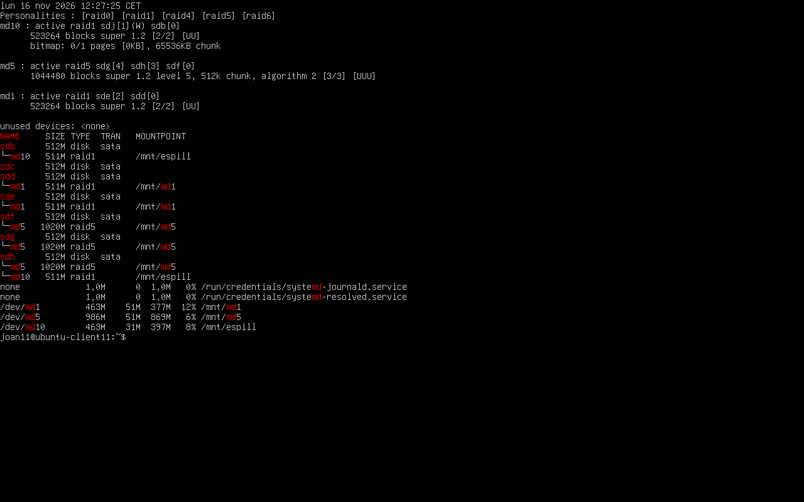
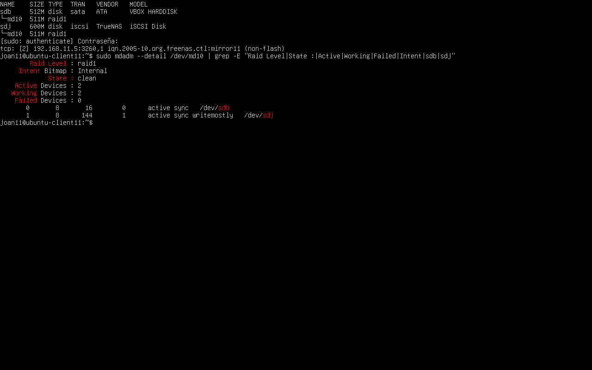

# Tasca 6 · Emmagatzematge i recuperació

**Alumne:** Joan Brotons Vidal · Posició 11 · **RA:** ISO RA3 a-h

| Què demana l'enunciat (individual) | On està |
|---|---|
| **Obligatori:** apartat 2 — crear almenys 3 tipus de RAID en un dels equips, verificar-ne el funcionament i explicar què guanyem amb cadascun | apartats 1 a 4 |
| **Apte+:** punt 3 — investigar com crear un RAID en espill entre 2 discos de 2 equips diferents, indicar una funcionalitat on siga interessant i dur-la a terme | apartat 5 |

---

> Evidència completa i sense retocar: [`evidencies/t6-raid.txt`](evidencies/t6-raid.txt)

## 1. Muntatge

| Element | Valor |
|---|---|
| Equip | VM `Ubuntu(Cliente)` · Ubuntu 26.04.1 LTS · `192.168.11.25` |
| Programari | `mdadm 4.5` (RAID per programari del nucli Linux) |
| Discos | 7 discos virtuals VDI de **512 MB** (`sdb`…`sdh`) al controlador SATA de la VM |
| Dades | Fitxers fictícis de 50 MB (`/dev/urandom`) amb el seu `sha256` per comprovar integritat |

Per què RAID per programari i no la "RAID" de VirtualBox: VirtualBox no ofereix RAID; cada disc virtual és un fitxer al mateix SSD de l'amfitrió. `mdadm` és el que s'utilitza en servidors Linux reals sense controladora RAID hardware, i permet provar fallades sense risc.

## 2. Arrays creats

| Array | Nivell | Discos | Capacitat bruta | Capacitat útil (`df`) | Tolera la fallada de |
|---|---|---|---|---|---|
| `/dev/md0` | RAID 0 (*striping*) | sdb, sdc | 1 GB | **986 MB** | **cap disc** |
| `/dev/md1` | RAID 1 (*mirroring*) | sdd, sde | 1 GB | **463 MB** | 1 disc |
| `/dev/md5` | RAID 5 (paritat distribuïda) | sdf, sdg, sdh | 1,5 GB | **986 MB** | 1 disc |

```text
md5 : active raid5 sdh[3] sdg[1] sdf[0]      1044480 blocks ... [3/3] [UUU]
md1 : active raid1 sde[1] sdd[0]             523264 blocks  ... [2/2] [UU]
md0 : active raid0 sdc[1] sdb[0]             1044480 blocks ... 512k chunks
```

> Després de les proves, el RAID 0 (`md0`) s'ha aturat per a reutilitzar `sdb` a l'espill remot (apartat 5). `md1` i `md5` continuen actius.

Persistència: arrays a `/etc/mdadm/mdadm.conf` (`mdadm --detail --scan`), `update-initramfs -u` i muntatge a `/etc/fstab` per etiqueta amb `nofail` (si un array no arrenca, el sistema no es queda bloquejat a l'arrencada).

## 3. Verificació del funcionament (proves de fallada)

| Prova | Què s'ha fet | Resultat observat |
|---|---|---|
| RAID 1 – fallada | `mdadm /dev/md1 --fail /dev/sde` | Estat `[2/1] [U_]`, `sha256sum -c` → **OK** (dades íntegres amb un sol disc) |
| RAID 1 – reconstrucció | `--remove`, `--zero-superblock`, `--add` | Resincronització completa en **5 s** (`State : clean`, 2 dispositius actius) |
| RAID 5 – fallada | `mdadm /dev/md5 --fail /dev/sdg` | `State : clean, degraded`, `sha256sum -c` → **OK** (dades reconstruïdes amb la paritat) |
| RAID 5 – reconstrucció | `--remove`, `--add` | Reconstrucció en **3 s**, `State : clean`, 3 actius |
| RAID 0 – fallada | `mdadm /dev/md0 --fail /dev/sdc` | `mdadm: Cannot remove /dev/sdc from /dev/md0, array will be failed.` → no hi ha redundància: perdre un disc és perdre-ho tot |

Els temps de reconstrucció són tan curts perquè els discos són de 512 MB i són fitxers al mateix SSD. En un disc real de 4 TB la reconstrucció pot durar hores i durant eixe temps l'array és vulnerable.

### Sobre les velocitats mesurades
`dd ... oflag=direct` va donar 1,5–2,1 GB/s als tres arrays. **No són xifres representatives**: els 7 discos virtuals són fitxers al mateix SSD USB de l'amfitrió i VirtualBox fa servir la memòria cau de l'amfitrió. L'amfitrió real (Kingston A400 per USB 3.0) no passa de ~300 MB/s de lectura (vegeu la [Tasca 7](Tasca7.md)). Per a comparar rendiments de RAID de veritat calen discos físics independents.

## 4. Què aporta cada tipus de RAID

| | RAID 0 | RAID 1 | RAID 5 |
|---|---|---|---|
| Idea | Reparteix els blocs entre discos | Còpia idèntica a cada disc | Reparteix dades + paritat (XOR) entre ≥3 discos |
| Espai útil | 100 % (N discos) | 50 % (1 disc) | (N-1)/N → 66 % amb 3 discos |
| Rendiment | Lectura i escriptura més ràpides | Lectura ràpida, escriptura igual que un disc | Lectura bona, escriptura penalitzada (càlcul de paritat) |
| Tolerància | Cap | 1 disc (o N-1) | 1 disc |
| Ús adequat a l'empresa | Dades temporals o reproduïbles (caché, *scratch*) | Sistema operatiu dels servidors, base de dades xicoteta | Carpetes compartides i còpies on importa la capacitat |

**Idea clau:** cap RAID és una còpia de seguretat. Si s'esborra un fitxer o hi ha un *ransomware*, el RAID replica l'error a tots els discos. Per això, a més del RAID, l'entorn té les còpies al TrueNAS ([Tasca 5](Tasca5.md)).

## 5. Ampliació (Apte+): RAID 1 en espill entre discos de **dos equips diferents**

> Evidències: [`evidencies/t6-espill-remot.txt`](evidencies/t6-espill-remot.txt) · [`evidencies/t6-espill-remot-truenas.txt`](evidencies/t6-espill-remot-truenas.txt)

### 5.1 Opcions estudiades
| Opció | Com funciona | Per què sí / per què no |
|---|---|---|
| **DRBD** | Mòdul del nucli que replica un dispositiu de blocs per xarxa entre dos Linux (primari/secundari). És el "RAID 1 per xarxa" clàssic | Necessita dos servidors Linux iguals amb DRBD. A l'entorn individual només hi ha un Linux de propòsit general (l'Ubuntu): el Debian és el tallafocs i no s'hi ha de posar emmagatzematge |
| ZFS `send/receive` | Còpies incrementals de snapshots a un altre equip | És replicació asíncrona (còpia periòdica), no un espill en temps real |
| **mdadm RAID 1 + iSCSI** ✅ | L'altre equip exporta un disc per xarxa (iSCSI) i el client el veu com un disc local `/dev/sdX`; mdadm fa l'espill entre el disc local i el remot | Utilitza el que ja hi ha (TrueNAS + Ubuntu), és síncron i es pot provar la fallada de l'equip remot. **Triada** |

### 5.2 Implementació
1. **TrueNAS (equip 1, `192.168.11.5`)**: zvol `Copias/iscsi-mirror11` de 600 MB, exportat per iSCSI. Portal `0.0.0.0:3260`, iniciador autoritzat `iqn.2026-11.local.joan11:ubuntu-client11`, target `iqn.2005-10.org.freenas.ctl:mirror11`, extent → LUN 0. Servei `iscsitarget` RUNNING.
2. **Ubuntu (equip 2, `192.168.11.25`)**: `open-iscsi`, descobriment (`sendtargets`) i login. El LUN apareix com a `/dev/sdi` (600 MB, `TRAN=iscsi`). Es reaprofita `sdb` (512 MB, abans del RAID 0 ja provat).
3. `mdadm --create /dev/md10 --level=1 --bitmap=internal /dev/sdb --write-mostly /dev/sdi`
   - `--write-mostly` al disc remot: les **lectures** es fan del disc local (ràpid) i les escriptures van als dos.
   - `--bitmap=internal`: si el remot cau un moment, en tornar només es copien els blocs que han canviat.
4. Persistència: node iSCSI amb `node.startup=automatic` i `/etc/fstab` amb `_netdev,nofail` (es munta quan hi ha xarxa i, si el NAS no hi és, el client arrenca igual).

### 5.3 Verificació
| Prova | Resultat |
|---|---|
| Estat inicial | `md10 : active raid1 sdi[1](W) sdb[0] [2/2] [UU]` (la `W` marca *write-mostly*) |
| Dades | Fitxer de 30 MB amb sha256 `8f73acb1…36b2` |
| **Cau l'equip remot** (logout iSCSI = el TrueNAS deixa de ser accessible) | `State : clean, degraded`, 1 dispositiu actiu. `sha256sum -c` → **OK**. Es poden continuar escrivint dades (`nou.txt`) |
| **Torna l'equip remot** (login + `--re-add`) | Resincronització en **7 s**. `State : clean`, 2 actius, `Intent Bitmap : Internal` |

### 5.4 Comprovació final (captures)

Després de reiniciar les VM, els arrays continuen actius. Això demostra que la configuració és persistent (`mdadm.conf`, `fstab` i node iSCSI automàtic):



`md1` (RAID 1) i `md5` (RAID 5) muntats a `/mnt/md1` i `/mnt/md5`, i `md10` (espill local + remot) a `/mnt/espill`, tots `[UU]`/`[UUU]`.



`sdj` és un disc de 600 MB amb `TRAN=iscsi` i fabricant `TrueNAS`, i hi ha una sessió iSCSI activa cap a `192.168.11.5:3260`. `md10` està `clean`, amb `sdb` (local) i `sdj` (remot, `writemostly`) sincronitzats. En tornar a connectar-se, el disc remot ha canviat de nom de `sdi` a `sdj`, però mdadm el reconeix igual perquè identifica els membres per l'UUID del superbloc, no pel nom del dispositiu.

### 5.5 Cas d'ús a l'empresa
Les dades d'un servidor (per exemple la carpeta compartida de Direcció) es guarden **alhora** al disc local i al NAS, que és **un altre equip físic**. Si el servidor perd el disc, les dades són senceres al NAS; si el NAS cau, el servidor continua treballant amb el seu disc i, quan torna, es resincronitza sol.
**Limitació:** no substitueix les còpies. Un esborrat o un *ransomware* també es replica a l'instant al NAS, igual que en qualsevol RAID 1. I la latència de la xarxa frena les escriptures, cosa que s'ha de tenir en compte amb molts usuaris.

## 6. Limitacions
- Tots els discos són al mateix disc físic: una fallada de l'SSD de l'amfitrió afectaria tots els "discos" alhora. És una simulació per aprendre el comportament, no protecció real.
