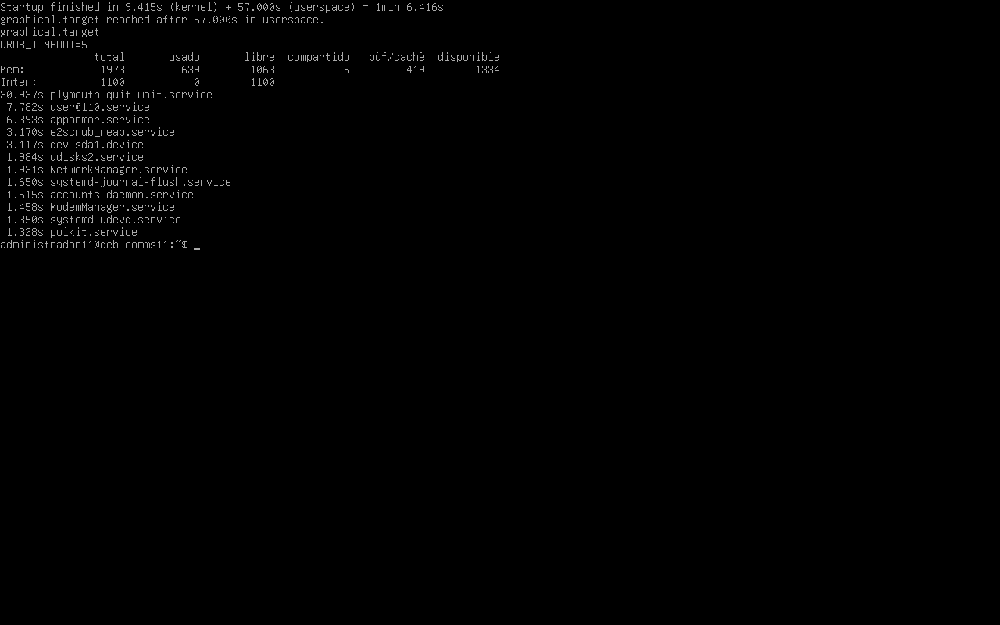
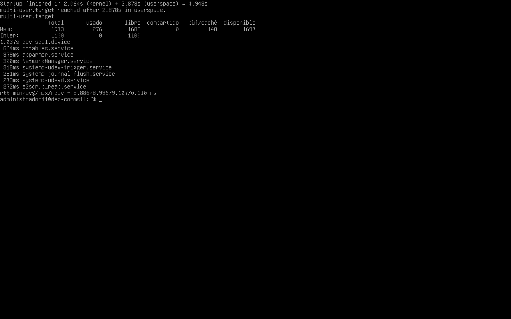

# Tasca 7 · Rendiment i diagnòstic

**Alumne:** Joan Brotons Vidal · Posició 11 · **RA:** ISO RA6 a-h · FDM RA1 e-g

| Què demana l'enunciat (individual) | On està |
|---|---|
| **Obligatori:** analitzar els recursos de la màquina física, comprovar quines VM saturen més un recurs o un altre, i fer un informe del que es satura en treballar amb cada màquina i de quantes VM es poden arrancar i fer servir sense bloquejar l'equip físic | apartats 1, 2 i 3 |
| **Apte+:** proposar i aplicar almenys dues optimitzacions a la configuració de les VM (recursos, serveis, arrencada…) i demostrar la millora amb mesures | apartat 4 |

---

## 1. Com s'ha mesurat

| Què | Eina | Evidència |
|---|---|---|
| CPU (us, sy, id, wa), RAM, swap | `vmstat`, `free` | [`t7-8vm-enceses.txt`](evidencies/t7-8vm-enceses.txt) |
| Disc de l'amfitrió (MB/s i % d'utilització) | `/proc/diskstats` (camps de sectors llegits/escrits i temps d'E/S de `sda`) | ídem |
| Xarxa | `/proc/net/dev` (`eno1`) | ídem |
| Temperatura | `/sys/class/thermal` (`x86_pkg_temp`) | ídem |
| E/S de cada VM per separat | `VBoxManage debugvm <vm> statistics` (bytes llegits pel disc virtual) | — |

Línia base de l'amfitrió (portàtil ASUS B3605CCA, Core Ultra 5 125H, 32 GB, SSD SATA per USB 3.0): vegeu la [Tasca 2](Tasca2.md).

## 2. Mesures

| Escenari | VM enceses | CPU lliure | RAM disponible | Disc `sda` (USB) | Temp. CPU | Evidència |
|---|---|---|---|---|---|---|
| Instal·lació del Windows Server | 7 (WS instal·lant) | 86-90 % | 11,5 GB | **~290 MB/s de lectura, 85 % d'ús** | — | [`t7-carrega-instalacio-winserver.txt`](evidencies/t7-carrega-instalacio-winserver.txt) |
| **Totes les VM enceses** (WS i W11 arrencant) | **8** | 87,5 % (wa 4,4 %) | **6,3 GB** de 31,3 GB · swap 0 | 25 MB/s d'escriptura, **87 % d'ús** | 73 °C | [`t7-8vm-enceses.txt`](evidencies/t7-8vm-enceses.txt) |
| WS congelat per TRIM (vegeu l'apartat 4) | 6 | ~92 % | 12,9 GB | **277 MB/s de lectura, 91 % d'ús** | — | [`t7-optimitzacio-discard.txt`](evidencies/t7-optimitzacio-discard.txt) |
| Equip de casa: Windows 11 instal·lant l'actualització acumulativa | 3 (W11, OPNsense, TrueNAS) | 92,7 % | 17,4 GB | 9 MB/s de lectura + 15 MB/s d'escriptura, **81 % d'ús** | 42 °C | [`t7-casa-win11-actualitzant.txt`](evidencies/t7-casa-win11-actualitzant.txt) |

## 3. Informe: què se satura i quantes VM es poden fer servir

**Què se satura:**
- **El disc és l'únic recurs que se satura.** En tots els escenaris amb càrrega arriba al 85-91 % d'utilització. La CPU continua al 86-92 % lliure, i la RAM no arriba mai a la swap.
- **Les VM que més disc consumeixen són les Windows** (Server 2025 i 11). En instal·lar, arrencar, actualitzar o fer TRIM fan lectures sostingudes de prop de 300 MB/s, que és el màxim de l'SSD per USB. Mentre passa això, la resta de VM i l'escriptori de l'amfitrió van lents. A casa, una actualització de Windows deixa el disc USB al 81 % d'ús movent només 24 MB/s: són operacions petites i aleatòries, i les limita la latència de l'SSD per USB (276 µs per operació, vegeu la [Tasca 2](Tasca2.md)), no el cabal.
- **Les que més RAM ocupen de veritat són les Windows**: n'ocupen tota l'assignada (4,3 GB el Windows 11). L'OPNsense té 3 GB assignats però n'ocupa ~0,5 GB a l'amfitrió (apartat 4.3). Les Linux, el TrueNAS i el MikroTik tenen entre 512 MB i 2 GB assignats i n'ocupen menys.
- **La CPU no és mai el problema:** 18 fils per a 11 vCPU en total.

**Quantes VM es poden arrancar:**
- **Les 8 VM caben a la vegada** (18,5 GB assignats). El portàtil no es bloqueja, però el disc va al 87 % i queden 6,3 GB de RAM per a l'amfitrió.
- **Per a treballar còmodament: 5-6 VM enceses**, és a dir, els servidors de comunicacions necessaris, el TrueNAS i la VM amb què s'està treballant. Les altres es guarden en estat (*savestate*), que no consumeix ni RAM ni CPU.
- **No s'ha d'arrancar ni actualitzar dos Windows alhora:** són les dues VM que saturen el disc.

## 4. Optimitzacions (Apte+)

### 4.1 Optimització 1: desactivar *discard/TRIM* al disc del Windows Server

| | Detall |
|---|---|
| **Problema** | El Windows Server es quedava congelat (pantalla i rellotge aturats) a la fase *specialize*, al primer inici de sessió i a l'escriptori. Mentrestant, el disc de l'amfitrió llegia contínuament a ~277 MB/s amb el 91 % d'ús |
| **Diagnòstic** | Les estadístiques de VirtualBox mostren que el disc virtual del WS **no llegeix res** (0 MB/s). Per tant, la lectura no la fa Windows sinó el procés de VirtualBox. En matar aquest procés, la lectura de l'amfitrió baixa de 245 MB/s a 0. La configuració del disc té `discard=on` sobre un VDI **dinàmic**: quan Windows llança el TRIM (ho fa després d'instal·lar i en optimitzar unitats), VirtualBox llig el fitxer `.vdi` per alliberar blocs i la VM queda bloquejada esperant |
| **Canvi** | `VBoxManage storageattach WinServer2025-DC … --nonrotational on --discard off` |
| **Resultat mesurat** | **Abans:** 277 MB/s de lectura sostinguda, 91 % d'ús i VM congelada. **Després:** la instal·lació dels rols del domini, la promoció a controlador de domini i dos reinicis s'han fet sense cap bloqueig, amb el disc de l'amfitrió a ~28 MB/s durant la instal·lació |
| **Inconvenient acceptat** | El VDI no s'encongeix sol quan s'esborren fitxers dins de Windows. Si cal recuperar espai, es fa a mà amb la VM aturada (`VBoxManage modifymedium --compact`) |

Evidència: [`evidencies/t7-optimitzacio-discard.txt`](evidencies/t7-optimitzacio-discard.txt)

### 4.2 Optimització 2: arrencada i serveis dels servidors de comunicacions

Mesurat a l'**equip de casa** (el mateix disc USB arrencat al sobretaula, vegeu la [Tasca 2](Tasca2.md)), amb les mateixes VM enceses de fons abans i després (OPNsense, TrueNAS i Windows 11 en repòs) i el disc de l'amfitrió en repòs (2 % d'ús).

| | Detall |
|---|---|
| **Problema detectat** | Totes les VM BIOS tenien l'ordre d'arrencada *disquet → DVD → disc*, el menú F12 de VirtualBox i controladors d'àudio i USB que un servidor no necessita. A més, el **Debian que fa de tallafocs tenia instal·lat l'escriptori GNOME**: arrancava en mode gràfic (`graphical.target`), amb `gdm`, impressió (`cups`), `avahi` i `ModemManager`, i el GRUB esperava 5 s. `systemd-analyze`: **1 min 6 s** fins a acabar l'arrencada, dels quals 30,9 s eren `plymouth-quit-wait` (l'espera de l'escriptori), i **639 MB de RAM** usats |
| **Canvis a VirtualBox** (Debian i MikroTik) | `VBoxManage modifyvm ... --boot1 disk --boot2 none --bios-boot-menu disabled --audio-enabled off --usb-ohci off --usb-ehci off --usb-xhci off` |
| **Canvis dins del Debian** | `systemctl set-default multi-user.target` (sense escriptori) · `systemctl disable --now cups cups.socket cups.path cups-browsed avahi-daemon avahi-daemon.socket ModemManager` · `GRUB_TIMEOUT=1` + `update-grub` |
| **Com es mesura** | S'engega la VM en fred (`VBoxManage startvm`) i es compten els segons fins que la seua WAN (en pont amb la xarxa de casa) respon al `ping`; després s'apaga per ACPI. 3 repeticions per VM. A més, `systemd-analyze` i `free -m` dins del Debian |

**Resultats:**

| VM | Abans | Després | Diferència |
|---|---|---|---|
| Debian · fins al ping a la WAN (3 proves) | 20,8 / 21,4 / 22,4 s → **21,5 s** | 17,1 / 18,1 / 16,3 s → **17,2 s** | **−4,3 s (−20 %)** |
| Debian · arrencada completa (`systemd-analyze`) | **1 min 6,4 s** (fins a `graphical.target`) | **4,9 s** (fins a `multi-user.target`) | **−61 s** |
| Debian · RAM usada (`free -m`) | **639 MB** | **276 MB** | **−363 MB (−57 %)** |
| MikroTik · fins al ping a la WAN (3 proves) | 18,4 / 18,4 / 17,8 s → **18,2 s** | 18,3 / 18,1 / 20,7 s → **19,0 s** | Cap millora (dins de la variació entre proves) |

Evidències: [`t7-arrencada-abans.txt`](evidencies/t7-arrencada-abans.txt) · [`t7-arrencada-despres.txt`](evidencies/t7-arrencada-despres.txt)

| | |
|---|---|
|  |  |
| Abans: 1 min 6 s, `graphical.target`, 639 MB | Després: 4,9 s, `multi-user.target`, 276 MB |

**Interpretació:**
- **Els canvis de VirtualBox no aporten res mesurable:** el MikroTik, que només ha tingut aquests canvis, tarda el mateix. Amb el disquet i el DVD buits, la BIOS els salta en mil·lisegons. Es mantenen perquè eviten arrencar per error una ISO que s'haja quedat al lector, però no són una optimització de rendiment.
- **La millora ve de dins del sistema:** traure l'escriptori i els serveis innecessaris i reduir l'espera del GRUB. Al ping es guanyen ~4 s (la xarxa ja s'aixecava abans que l'escriptori), però el sistema queda **completament arrancat en 5 s en lloc d'1 minut** i allibera més de la meitat de la RAM. Un tallafocs amb menys serveis també té menys superfície d'atac.
- **Comprovació funcional després del canvi:** `nftables` es carrega (664 ms a `systemd-analyze blame`), el Debian surt a Internet (`ping 1.1.1.1`) i, des del Windows 11, respon el ping a `192.168.11.3`.
- **Inconvenient acceptat:** el Debian ja no té entorn gràfic. S'administra per SSH o per consola, que és el normal en un servidor.

### 4.3 Observació sobre la RAM (per què no s'ha optimitzat retallant-la)

La proposta inicial era reduir la RAM assignada. Abans d'aplicar-la s'ha mesurat quanta RAM ocupa realment cada VM a l'amfitrió (RSS del procés `VBoxHeadless` de cada VM, amb `ps`) després d'arrancar en fred:

| VM | Assignada | Ocupada realment a l'amfitrió |
|---|---|---|
| Windows 11 | 4.096 MB | **4.368 MB** |
| OPNsense | 3.096 MB | **497 MB** |
| TrueNAS | 2.048 MB | **652 MB** |

VirtualBox només reserva la memòria que el sistema convidat toca. Els Linux/BSD n'usen poca i, per tant, retallar-los la RAM assignada **no allibera gairebé res** a l'amfitrió. En canvi, Windows inicialitza tota la memòria en arrancar i n'ocupa tota l'assignada. Per tant, la RAM la saturen les VM Windows, i només baixar-los la RAM es notaria, però el Windows 11 ja està al mínim oficial (4 GB). Per això s'ha optat per l'optimització de l'apartat 4.2, que sí té una millora mesurable.

**Nota:** a les mesures de classe (apartat 2) les VM es reprenien des d'estat guardat, i això carrega tota la memòria que tenien en guardar-se.
