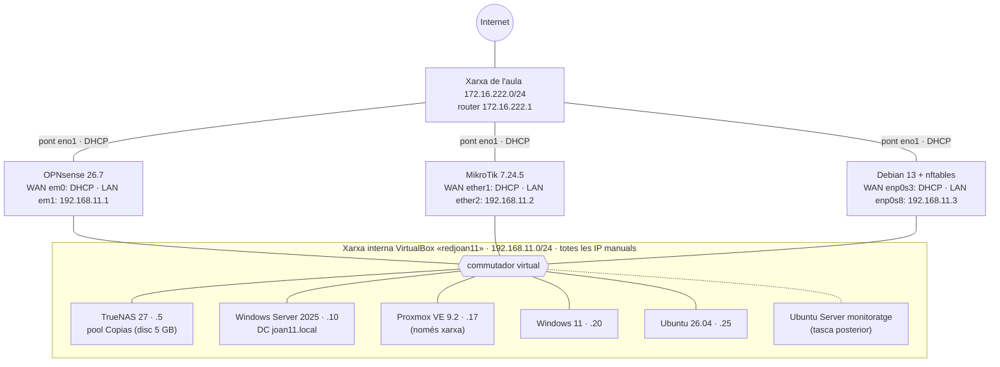

# Tasca 4 · Esquema de xarxa individual i configuració de les interfícies

**RA:** ISO RA1 · Posició a l'aula: **11** → LAN **`192.168.11.0/24`**

## 1. Esquema (lògic + muntatge a VirtualBox)

## 2. Configuració de cada interfície

Màscara de tota la LAN: `255.255.255.0` (/24). Passarel·la per defecte de tots els equips de la LAN: **`192.168.11.1`**. DNS: `192.168.11.1` (Unbound a l'OPNsense) i `192.168.11.3` (dnsmasq al Debian). Al domini, el DNS del DC és `192.168.11.10` (vegeu [T5.4](T5-4-windows-server.md)).

| Equip | Interfície | Adaptador VirtualBox | Mètode | IP / màscara | Passarel·la | DNS |
|---|---|---|---|---|---|---|
| OPNsense | em0 (WAN) | Pont `eno1` | DHCP | 172.16.222.184/24* | 172.16.222.1 | de l'aula |
| | em1 (LAN) | Xarxa interna `redjoan11` | Estàtica | 192.168.11.1/24 | — | Unbound local |
| MikroTik | ether1 (WAN) | Pont `eno1` | DHCP | 172.16.222.213/24* | 172.16.222.1 | de l'aula |
| | ether2 (LAN) | `redjoan11` | Estàtica | 192.168.11.2/24 | — | — |
| Debian comms | enp0s3 (WAN) | Pont `eno1` | DHCP | 172.16.222.195/24* | 172.16.222.1 | de l'aula |
| | enp0s8 (LAN) | `redjoan11` | Estàtica | 192.168.11.3/24 | — | 127.0.0.1 (dnsmasq) |
| TrueNAS | enp0s3 | `redjoan11` | Estàtica | 192.168.11.5/24 | 192.168.11.1 | .1, .3 |
| Windows Server 2025 | Ethernet | `redjoan11` | Estàtica | 192.168.11.10/24 | 192.168.11.1 | 127.0.0.1 (DC), .1 |
| Proxmox | vmbr0 (pont sobre nic0) | `redjoan11` | Estàtica | 192.168.11.17/24 | 192.168.11.1 | .1, .3 |
| Windows 11 | Ethernet | `redjoan11` | Estàtica | 192.168.11.20/24 | 192.168.11.1 | .10, .1 |
| Ubuntu client | enp0s3 (`lan-estatica`) | `redjoan11` | Estàtica | 192.168.11.25/24 | 192.168.11.1 | .1, .3 |

\* Les IP WAN les assigna el DHCP de l'aula i poden canviar. A casa, el pont dona una IP de la xarxa domèstica (o es pot canviar l'adaptador a NAT de VirtualBox).

**Per què xarxa interna i no NAT/pont per a la LAN:** la xarxa interna `redjoan11` només existeix dins del meu VirtualBox. Cap DHCP ni trànsit de la LAN pot eixir a la xarxa compartida de l'aula (l'enunciat prohibeix llançar un DHCP de proves a la xarxa compartida), i l'única eixida és a través dels servidors de comunicacions.

## 3. Comprovació de la connectivitat (Apte+)

Evidència: [`evidencies/t5-proves-firewall-client.txt`](../evidencies/t5-proves-firewall-client.txt) i [`evidencies/t4-connectivitat.txt`](../evidencies/t4-connectivitat.txt)

- **Camí del trànsit** (tracepath des de l'Ubuntu `.25`):
  `192.168.11.1` (OPNsense) → `172.16.222.1` (router de l'aula) → `172.18.22.1` (xarxa del centre) → Internet. Canviant la passarel·la a `.2` o `.3`, el primer salt passa a ser el MikroTik o el Debian.
- **Taules d'encaminament**: cada equip de la LAN té una sola ruta per defecte cap a `192.168.11.1`. Els tres routers tenen la ruta per defecte cap a `172.16.222.1` per la WAN.
- **Eixida a Internet**: HTTP a `deb.debian.org` correcte per les tres passarel·les.
- **ICMP cap a Internet**: el `ping 8.8.8.8` **falla des de l'aula, també des de l'amfitrió**. És un filtre de la xarxa del centre, no un error del muntatge. La prova d'eixida es fa per HTTP/DNS.
